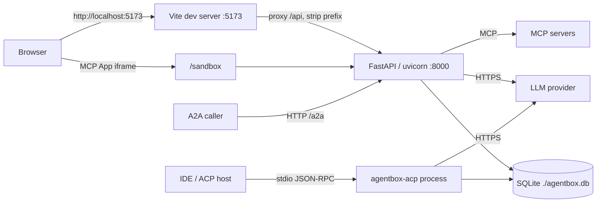
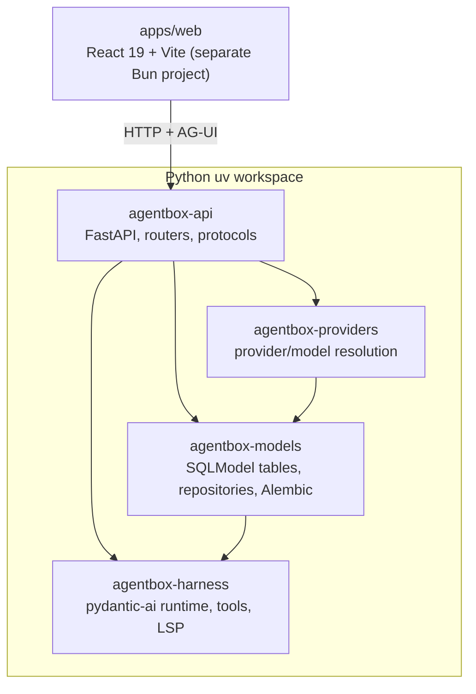

# System Overview

**Scope:** What Agentbox is, the constraints that shape its architecture, how the processes fit
together, and which cross-cutting decisions recur throughout the codebase. Detailed treatment
lives in the linked documents.

## Intent and constraints

Agentbox exists to make a local folder usable by tool-using LLM agents while staying hackable and
observable. Four constraints drive most structural decisions.

| Constraint | Consequence |
|---|---|
| Protocol compliance over homegrown plumbing | Wire formats come from official SDKs or pydantic-ai adapters: AG-UI for web streaming, ACP for IDEs, A2A for agent-to-agent, MCP for external tools. |
| Local-first and self-hosted | One SQLite database, one backend process, one web app. No hosted control plane or external queue is required. |
| Ambition in the UI | The frontend is a composed product: a design-system shell, a typed event bus, and dedicated chat rendering rather than a generic form over an API. |
| Async where possible | FastAPI, SQLModel/SQLAlchemy, and pydantic-ai are driven asynchronously; long-running work is task-based and cancellable. |

A second-order constraint is that the harness must be protocol-agnostic. The same agent runtime
serves HTTP/AG-UI, stdio/ACP, HTTP/A2A, and session-spawned subagent sessions. Protocol adapters
translate events and lifecycle calls; they do not reimplement agent behavior.

## Runtime topology

In local development the browser loads the Vite dev server on port 5173. Vite proxies requests
under `/api` to the FastAPI/uvicorn backend on port 8000 and strips the prefix, so the web app
uses the same relative API paths in development and production. MCP App iframes talk directly to
the backend's `/sandbox` endpoint. The backend owns the SQLite file (`./agentbox.db` by default)
and calls out to LLM providers and MCP servers over the network.

Two additional entry points reuse the same harness and database:

- **ACP adapter:** the `agentbox-acp` console script (or `python -m agentbox_api.acp_server`)
  runs a stdio JSON-RPC agent for an IDE. It is a separate process, not an HTTP client.
- **A2A:** the backend mounts `/a2a` and exposes only agents that have a stored agent card.

*Figure 1 — Local runtime topology.*

## Package dependency direction

The Python code is a uv workspace whose packages depend downward. Dependencies point from the
API toward the runtime, never the reverse: the harness knows nothing about HTTP or the database.

*Figure 2 — Python package dependency direction.*

`apps/web` is a separate Bun project, not a uv workspace member. It consumes the backend through
generated OpenAPI types and the AG-UI event stream.

> **Implementation note:** the downward rule has two intentional upward imports. The model-layer
> repositories import harness domain types so they can serialize `AgentSpec` and conversation
> turns: `agentbox_models.repos.agents` imports from `agentbox_harness.spec`, and
> `agentbox_models.repos.message_log` imports `Turn` from `agentbox_harness.session`. In practice
> `agentbox-models` therefore depends on a subset of the harness contract, not just the reverse.

## Composition root

There is intentionally no module-level FastAPI `app`. The application is built explicitly:

- `agentbox_api.app.create_app(settings, engine=None, session_factory=None)` constructs the
  engine if needed, wires lifespan startup/shutdown, middleware, routers, `/sandbox`, and the
  `/a2a` mount.
- `python -m agentbox_api.dev_server` calls `SQLModel.create_all`, seeds an admin user, and runs
  uvicorn on `127.0.0.1:8000`.
- `agentbox-acp` builds its own settings and engine and serves ACP over stdio.

This keeps configuration and test construction explicit and avoids import-time side effects. See
[Backend](03-backend.md) for the wiring details.

## Cross-cutting decisions

| Decision | Rationale | Trade-off | Detail in |
|---|---|---|---|
| Protocol adapters over a shared harness | One runtime, four transports; protocol behavior stays thin and testable. | Each adapter must map its own event and lifecycle semantics. | [07](07-protocols.md) |
| Turn-chain persistence | History is an immutable parent-linked chain, which makes fork, retry, and compaction structural rather than ad hoc. | Reads must walk the chain; no ORM relationships or cascades. | [05](05-data-model.md) |
| Session-scoped stdio MCP processes | Expensive servers start once per session and are reused across turns. | Bindings are captured when the toolset starts; edits do not affect a live session until it is closed or swept. | [07](07-protocols.md) |
| Scope-based authorization | JWT users get role-derived scopes; API keys carry their own subset. One `require_permission` pattern covers HTTP and A2A. | Route access is enforced server-side only; the UI merely hides navigation. | [06](06-auth-and-security.md) |
| JSON-text agent definitions | Tool bindings and modes are stored flexibly without schema churn. | Validation and migration are application-level; columns are opaque to SQL. | [05](05-data-model.md) |
| Async throughout | Streaming, MCP processes, LSP, and terminals are concurrent and cancellable. | Requires careful lifecycle and cleanup coupling. | [10](10-concurrency-and-lifecycle.md) |
| Local-first single SQLite | Zero external infrastructure; simple backup and inspection. | One writer and process-local state; A2A tasks and some caches do not survive restart. | [05](05-data-model.md) |

## Related

- [Technology stack](02-tech-stack.md)
- [Backend](03-backend.md)
- [Harness and runtime](04-harness-runtime.md)
- [Data model](05-data-model.md)
- [Index](README.md)
