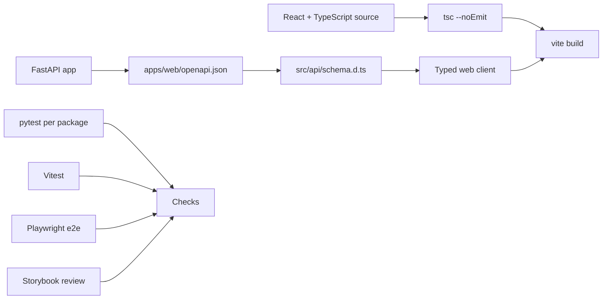
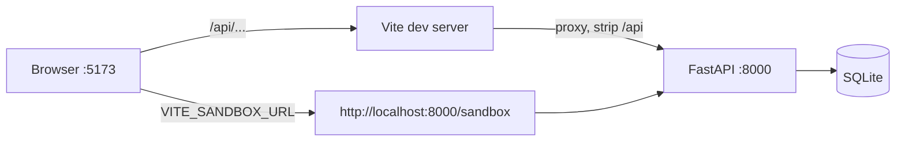

# Technology Stack

**Scope:** The languages, libraries, tooling, ports, and generated artifacts that make up the
project, and why the notable dependencies exist. Version floors come from the package manifests;
exact resolved versions live in `uv.lock` and `apps/web/bun.lock`.

## Backend stack

The backend is a Python 3.11 uv workspace with four packages.

| Layer | Technology | Version floor | Role |
|---|---|---|---|
| Runtime | Python | 3.11 (`requires-python`) | Language for all Python packages |
| Workspace | uv | workspace members `packages/*` | Dependency resolution and command runner |
| Web framework | FastAPI | `>=0.115` | Routers, dependencies, app factory |
| ASGI server | uvicorn | `>=0.30` | Serves the dev server and production app |
| Authentication | Starlette `AuthenticationMiddleware` | bundled with FastAPI | JWT and API-key authentication backend |
| Tokens | PyJWT | `>=2.8` | JWT creation and decoding |
| Passwords | bcrypt | `>=4.0` | Password hashing |
| Configuration | pydantic-settings | `>=2.0` | `Settings` from environment and `.env` |
| Agent runtime | pydantic-ai | `>=2.0` (API/providers), `>=0.0.1` (harness) | Agent construction, runs, streaming, AG-UI adapter |
| AG-UI | pydantic-ai `[ag-ui]` extra | via API package | SSE event translation |
| ACP | agent-client-protocol | `>=1.0` | IDE adapter over stdio |
| A2A | a2a-sdk `[fastapi]` | `>=1.3` | Agent cards and JSON-RPC |
| MCP | pydantic-ai MCP toolset + stdio transport | via pydantic-ai | External tools and MCP Apps |
| Persistence | SQLModel | `>=0.0.14` | Table definitions |
| ORM/driver | SQLAlchemy `[asyncio]` | `>=2.0` | Async engine and sessions |
| SQLite driver | aiosqlite | `>=0.19` | Async SQLite |
| Migrations | Alembic | `>=1.13` | Schema evolution |
| Logging | loguru | `>=0.7` | Structured backend logging and sinks |
| Templating | Jinja2 | `>=3.1` | Sandboxed system-prompt templates |
| Assets | Pillow, robohash | `>=9.1`, `>=2.0` | Avatar normalization and defaults |
| Skills | skills-ref | `>=0.1` | Skill discovery/format helpers |
| Search/fetch | ddgs, httpx, trafilatura | `>=9.0`, `>=0.27`, `>=2.0` | Web search, HTTP, HTML extraction |

Development tooling: pytest, pytest-asyncio, pytest-timeout (every package sets `timeout = 60`),
Ruff (line length 100, target py311, first-party `agentbox_*`), `ty` for type checking, and
bandit.

## Frontend stack

The web app is a standalone Bun project under `apps/web`.

| Layer | Technology | Version range | Role |
|---|---|---|---|
| UI runtime | React / React DOM | `^19.3.1` | Component model |
| Build | Vite | `^8.3.8` | Dev server, proxy, production build |
| Language | TypeScript | `5` (strict) | Type checking before build |
| Component library | Mantine core/hooks/modals/notifications | `^9.8.1` | Design-system base |
| Server state | TanStack Query | `^5.108.0` | Query cache, mutations, invalidation |
| Client state | Zustand | `^5.1.0` | Auth token/user store |
| Routing | React Router DOM | `^7.18.6` | `BrowserRouter` and routes |
| API client | openapi-fetch / openapi-typescript | `^0.17.0` / `^7.13.0` | Typed HTTP client and generated schema |
| Streaming | `@ag-ui/core`, `@ag-ui/client` | `^1.0.5` | Event types; client abstractions currently unused |
| MCP Apps | `@mcp-ui/client` | `^7.1.1` | Sandboxed app renderer |
| Markdown | react-markdown, remark-gfm | `^10.1.0`, `^4.0.1` | Message rendering |
| Code | highlight.js | `^11.12.0` | Syntax highlighting |
| Diagrams | mermaid, react-zoom-pan-pinch | `^12.3.0`, `^4.2.0` | Rendered diagrams with pan/zoom |
| Events | mitt | `^3.0.1` | Typed application event bus |
| Icons | `@remixicon/react` | `^4.9.0` | Line icon set |
| Fonts | `@fontsource/*` | `5.3.0` | Silkscreen, Inter, JetBrains Mono |

Development tooling: Vitest 5 with jsdom, Testing Library, Playwright, Storybook 10 with
`addon-docs` and `addon-a11y`, and `tsc --noEmit`.

## Tooling and pipelines

- **uv** manages Python dependencies and runs commands from the repo root.
- **Bun** manages the frontend (`bun.lock`); do not use npm or pnpm.
- **just** is a convenience wrapper: `setup`, `dev`, `lint`, `test`, `e2e`, `codegen`, `verify`,
  `migrate`. `just verify` runs format, lint, all tests, and the web build.
- **Ruff** is the formatter/linter; **ty** is the type checker.
- **pytest** runs one package per invocation. Passing multiple package directories in one run
  causes duplicate `test_scaffold.py` basenames to collide during collection.
- **Vitest** runs colocated `*.test.ts(x)` under `src` with `jsdom`.
- **Playwright** runs specs in `apps/web/e2e` against a prepared database and stub servers.
- **Storybook** is the design-system review surface.

## Local development topology

| Process | Port | Notes |
|---|---|---|
| Backend (`uv run python -m agentbox_api.dev_server`) | 8000 | Binds `127.0.0.1`, seeds `admin`/`admin` |
| Vite dev server (`bun run dev`) | 5173 | Proxies `/api` to 8000 and strips the prefix |
| Storybook (`bun run storybook`) | 6006 | Component review |
| e2e stub model server | 9999 | Test-only |
| e2e MCP app server | 9000 | Test-only |

The database defaults to `./agentbox.db` through `DATABASE_URL`
(`sqlite+aiosqlite:///./agentbox.db`). `JWT_SECRET` must be at least 32 characters. The Vite
proxy means the app calls `/api/...` in both dev and production.

## Generated artifacts

Two files are generated and must never be hand-edited:

- `apps/web/openapi.json` — exported from the FastAPI app by
  `uv run python apps/web/scripts/gen-openapi.py`.
- `apps/web/src/api/schema.d.ts` — produced by `openapi-typescript` from that document via
  `bun run codegen`.

After any backend route or schema change, regenerate both in order; the frontend client and
tests compile against the generated types.

*Figure 1 — Build and generation pipeline.*

## Why these dependencies

| Dependency | Why it exists |
|---|---|
| pydantic-ai | Owns the agent loop, tool calling, streaming events, and the AG-UI adapter. |
| agent-client-protocol | Official ACP types and stdio server, so the IDE protocol is not homegrown. |
| a2a-sdk | Official A2A card and JSON-RPC server primitives. |
| MCP via pydantic-ai | One tool abstraction covers remote and stdio MCP servers. |
| SQLModel + Alembic | Table models and migrations in one Python stack. |
| Mantine | Provides accessible primitives; the app layers its own tokens and patterns on top. |
| openapi-fetch + openapi-typescript | End-to-end types from the backend without hand-written clients. |
| TanStack Query | Server-state caching, polling, and invalidation. |
| Zustand | Minimal persistent auth store outside React context. |
| Mermaid | Diagrams render as SVG from the agent's Markdown output. |
| mitt | A thin typed bus for cross-cutting UI events (currently reserved; see frontend notes). |

*Figure 2 — Local dev request flow.*

## Related

- [System overview](01-system-overview.md)
- [Backend](03-backend.md)
- [Frontend](08-frontend.md)
- [Testing and observability](11-testing-and-observability.md)
- [Index](README.md)
