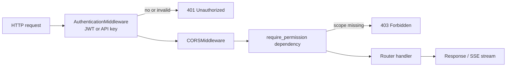
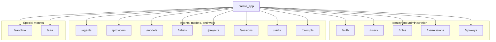
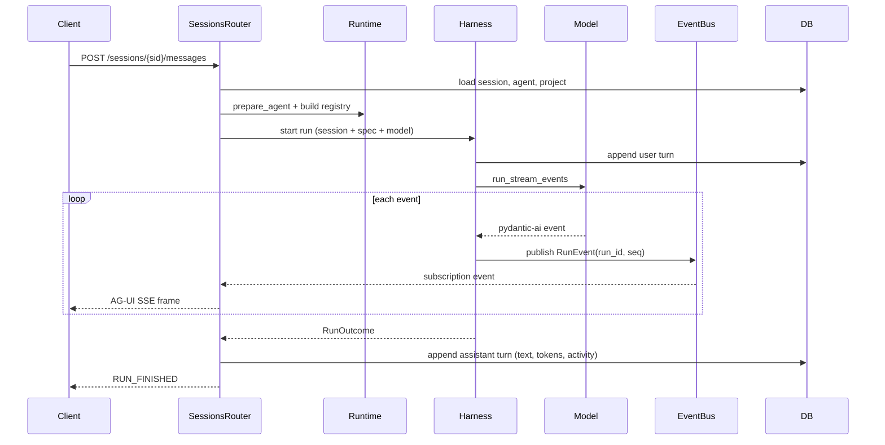

# Backend

**Scope:** How `agentbox-api` is composed: the module layout, application factory, request
middleware, HTTP surface, chat turn flow, configuration, logging, and error handling. The agent
runtime itself is covered in [Harness and runtime](04-harness-runtime.md).

## Module map

| Module | Responsibility |
|---|---|
| `app.py` | `create_app`, lifespan, middleware, router registration, `/sandbox`, `/a2a` mount |
| `config.py` | `Settings` (pydantic-settings) and environment mapping |
| `deps.py` | `get_session` and the `require_permission` dependency factory |
| `security.py` | Password hashing, JWT create/decode, API-key hashing |
| `auth_backend.py` | Starlette authentication backend for JWT and API keys |
| `runs.py` | `RunRegistry`: session id to active cancellable run |
| `runtime.py` | Composition root for a turn; `build_registry`, `AgentRuntime`, `resolve_agent_runtime`, `delete_session_data` |
| `streaming.py` | AG-UI SSE adapter |
| `activity.py` | `RunActivityCollector`: reasoning/tool timings and final text for persistence |
| `skills.py` | Skill discovery/merge, catalog, activation, `prepare_agent` runtime assembly |
| `plan_tools.py` | TODO-style plan tools backed by `PlanItem` |
| `project_instructions.py` | `AGENTS.md` discovery, instruction blocks, post-tool nested instructions |
| `templating.py` | Sandboxed Jinja2 prompt rendering and preview |
| `mcp_relay.py` | Backend proxy for MCP Apps resource reads and tool calls |
| `subagent_sessions.py` | Subagent session manager: live output, wait, caps, recursive cancellation, restart reconciliation |
| `sandbox.py` | MCP App proxy iframe HTML and CSP |
| `avatars.py` | RoboHash defaults and uploaded-avatar normalization |
| `logging.py` | loguru sinks and stdlib interception |
| `validation.py` | Name, password, directory, and URL validators |
| `dev_server.py` / `dev_seed.py` | `create_all`, admin seed, uvicorn |
| `acp_server.py` | ACP stdio adapter (`agentbox-acp`) |
| `a2a_server.py` / `a2a_executor.py` | A2A dispatcher, cards, executor |
| `routers/*.py` | HTTP endpoints |

## Application factory and lifespan

`create_app(settings, engine=None, session_factory=None)` is the only way to construct the app.
It creates an async engine and session factory when not supplied, then stores `engine`,
`session_factory`, `settings`, and `run_registry` on `app.state`.

Startup, in order:

1. `configure_logging(settings)` and `configure_lsp(settings)`.
2. Obtain the global `McpSessionManager` and set its start timeout.
3. Start a background task that calls `manager.sweep_idle(...)` every
   `mcp_sweep_interval_seconds`.
4. `reconcile_running_subagent_sessions(session_factory)`: mark any subagent session left
   `running` by a previous process as `failed`.

Shutdown, in order:

1. Cancel and await the MCP sweep task.
2. `mcp_manager.close_all()`.
3. Shut down the global LSP manager.
4. Shut down the global terminal job manager.
5. Shut down all subagent sessions.
6. Dispose the database engine.

There is no module-level `app`. `python -m agentbox_api.dev_server` calls `create_all`, seeds an
admin user, and runs uvicorn; production callers build the app with their own settings.

## Middleware chain

Starlette's `AuthenticationMiddleware` runs first, then CORS. Authentication resolves the bearer
token to a `CurrentUser` plus scope list; a router's `require_permission(...)` dependency then
authorizes the specific action.

*Figure 1 — Request middleware chain.*

CORS allows the configured origins (`http://localhost:5173` by default), credentials, all methods,
and all headers.

## API surface

All routers are `APIRouter(prefix=..., tags=[...])` instances included by `create_app`.

| Prefix | Tag | Responsibility | Notable endpoints |
|---|---|---|---|
| `/auth` | `auth` | Login, registration, current user | `POST /auth/login`, `POST /auth/register`, `GET /auth/me` |
| `/agents` | `agents` | Agent CRUD, avatars, A2A cards | `GET/POST /agents`, `GET/PUT/DELETE /agents/{name}`, `GET/PUT/DELETE /agents/{name}/avatar`, `GET/PUT/DELETE /agents/{name}/card` |
| `/providers` | `providers` | Provider CRUD, connection test, model refresh | `POST /providers/test`, `POST /providers/{id}/models/refresh` |
| `/models` | `models` | Model CRUD and label assignment | `PUT /models/{id}/labels` |
| `/permissions` | `permissions` | Permission CRUD | `GET/POST /permissions`, `PUT/DELETE /permissions/{id}` |
| `/projects` | `projects` | Project CRUD and extra roots | `GET/POST /projects`, `PUT/DELETE /projects/{id}` |
| `/prompts` | `prompts` | Sandboxed prompt preview | `POST /prompts/preview` |
| `/sessions` | `sessions` | Sessions, messages/stream, cancel, attachments, files, LSP, plan, MCP relay | `POST /sessions/{sid}/messages`, `POST /sessions/{sid}/messages/cancel`, `GET /sessions/{sid}/messages`, `GET /sessions/{sid}/files`, `GET /sessions/{sid}/lsp`, `GET /sessions/{sid}/plan` |
| `/users` | `users` | User CRUD and role assignment | `GET/PUT /users/{uid}/roles` |
| `/roles` | `roles` | Role CRUD and permission assignment | `GET/PUT /roles/{rid}/permissions` |
| `/api-keys` | `api-keys` | Scoped personal API keys | `POST/GET/DELETE /api-keys` |
| `/labels` | `labels` | Model labels | `GET /labels` |
| `/skills` | `skills` | User skill CRUD | `GET/PUT/DELETE /skills/{name}` |
| `/sandbox` | hidden | MCP App proxy page | `GET /sandbox?csp=...` |
| `/llms.txt`, `/llms/{section}.md` | hidden | Public agent-facing Markdown guide | `GET /llms.txt`, `GET /llms/authentication.md` |
| `/a2a` | mount | Per-agent A2A card and JSON-RPC | `/{agent}/.well-known/agent-card.json`, `/{agent}` JSON-RPC |

*Figure 2 — Router map.*

## Turn request flow

A chat turn is `POST /sessions/{sid}/messages`, which returns an SSE stream.

1. Load the `SessionRow`, `Agent`, and `Project`.
2. `prepare_agent` resolves the model (`Agent` → `Model` → `Provider` →
   `agentbox_providers.resolve_model`), loads the `AgentSpec`, discovers skills, renders the
   system prompt, appends the skill catalog and `AGENTS.md` blocks, and adds plan and terminal
   tools.
3. Build the tool registry with native tools and post-tool hooks (LSP diagnostics, nested
   instructions), plus an API-backed subagent session runner.
4. Construct a harness `Session` over `DatabaseMessageLogStore`. The starting head depends on the
   request: retry targets a user turn without re-recording it; fork starts from
   `fork_from_turn_id`; a normal turn starts from the last leaf.
5. Convert attachment rows and the selected skill into the prompt prefix.
6. Auto-title the session on the first message.
7. Build the `Harness`, start stdio MCP toolsets, create an `EventBus`, and start the run.
8. Register the run in `RunRegistry` under the session id.
9. Stream pydantic-ai events through `RunActivityCollector` and `AGUIEventStream` as SSE frames.
10. In a separate `finish()` task, await the run outcome and persist the assistant turn with its
    text, `context_tokens`, and activity summary; close the bus and finish the registry entry.

*Figure 3 — HTTP chat turn.*

## Configuration

`Settings` is a pydantic-settings model reading `agentbox.toml`, `.env`, and environment
variables (uppercase field names). `jwt_secret` is required and must be at least 32 characters.
The shared resolver lives in `agentbox_models.config`; Alembic uses it too.

| Group | Fields |
|---|---|
| Database | `database_url` resolved from `agentbox.toml`/`DATABASE_URL`/`DATABASE_*` (default `sqlite+aiosqlite:///./agentbox.db`) |
| Storage | `media_dir` (default `./media`) |
| JWT | `jwt_secret`, `jwt_algorithm` (default HS256), `jwt_expiry_seconds` (default 3600) |
| CORS | `cors_origins` (default `["http://localhost:5173"]`) |
| A2A | `a2a_workspace`, `a2a_public_url` |
| Skills | `skills_user_dir` (default `~/.agents/skills`) |
| Media | `media_max_dimension`, `media_max_bytes` |
| Logging | `log_level`, `log_dir`, `log_rotation`, `log_retention`, `log_compression`, `log_intercept` |
| LSP | `lsp_enabled`, `lsp_mode` (`auto`/`on_demand`/`off`), `lsp_servers_json`, `lsp_initialize_timeout`, `lsp_diagnostics_timeout`, `lsp_failure_backoff_seconds`, `lsp_max_open_documents`, `lsp_first_change_timeout`, `lsp_settle_window`, `lsp_session_snapshot_limit`, `lsp_warm_on_start` |
| Web search | `web_search_provider`, `web_search_timeout`, `web_search_max_results`, `web_search_region`, `web_search_safesearch`, `web_search_ddgs_backend`, `searxng_url` |
| Web fetch | `web_fetch_timeout`, `web_fetch_max_chars`, `web_fetch_max_bytes`, `web_fetch_user_agent` |
| Compaction | `compaction_enabled`, `compaction_ratio`, `compaction_keep_turns`, `compaction_input_budget_tokens`, `compaction_max_summary_chars` |
| Context editing | `context_editing_enabled`, `context_editing_trigger_tokens`, `context_editing_trigger_ratio`, `context_editing_target_ratio`, `context_editing_keep_tool_results`, `context_editing_keep_recent_messages`, `context_editing_clear_tool_inputs`, `context_editing_clear_binary`, `context_editing_exclude_tools`, `context_editing_placeholder`, `context_editing_binary_placeholder` |
| MCP | `mcp_idle_ttl_seconds`, `mcp_start_timeout_seconds`, `mcp_sweep_interval_seconds` |
| Plugins | `plugins_user_dir` (default `~/.agents/plugins`), `plugins_data_dir` (default `~/.agents/plugins/data`) |

`lsp_mode=auto` (default) analyses edited files in the background and delivers a compact
next-run reminder; `on_demand` exposes only the `lsp_diagnostics` tool; `off` disables LSP servers,
hooks, and the tool. `lsp_enabled=false` remains an alias for `off`.

Agent Plugins v1.0.0 packages are discovered from `plugins_user_dir` and project `.agents/plugins`.
Manifests and `mcp.json` are validated locally against vendored official schemas; enabled plugins
contribute namespaced skills and MCP servers that agents select explicitly. Plugin state is stored
per scope in `pluginstate`; plugin MCP references live in `agent_plugin_mcp_binding` and resolve at
`prepare_agent` time.

Enabled plugins may also declare `com.agentbox/hooks/hooks.json` lifecycle hooks.
Hooks map session/run/tool events to pydantic-ai capability hooks, execute
commands or HTTP calls with timeouts and sanitized environments, and may inject
context, mutate tool arguments/results, or deny a tool call. Hook failures are
fail-open by default; `on_error: deny` makes a failed `before_tool` hook deny the
call. `session_start`/`session_end` are process-scoped and best-effort.

Context editing runs inside each agent run through pydantic-ai's `ProcessHistory` capability. When
the estimated request exceeds `min(context_editing_trigger_tokens, trigger_ratio * context_window)`,
it replaces old tool returns and binary attachments with placeholders until the estimate reaches
`target_ratio`, keeping the last `keep_tool_results` tool returns and the last
`keep_recent_messages` messages. Compaction remains the fallback for text-heavy histories.

The app uses an async `database_url` and normalizes common sync URLs to async drivers. Alembic
reads the same TOML/env resolver and runs through an async engine when the URL requires one.
Schema changes need a migration; the dev server's `create_all` does not alter existing databases.
Avatars, session attachments, and A2A cards are stored under `media_dir` with metadata in
`media_file`; back up the database and media directory together. Foreign-key conflicts on delete
return `409 Conflict`.

## Logging

`configure_logging` removes loguru's default handler and installs:

- a colored stderr sink at the configured level;
- a rotating file sink at `{log_dir}/agentbox.log` with rotation, retention, and compression,
  `enqueue=True`, and `diagnose=False`;
- optional interception of stdlib loggers (root, uvicorn, starlette, sqlalchemy, asyncio) through
  `InterceptHandler`.

Logging never writes to stdout, because the ACP adapter uses stdout for JSON-RPC framing.

## Error model and cancellation

Router handlers raise FastAPI `HTTPException` with a `detail`. Harness runs normalize failures
into `RunOutcome`, mapping `RunCancelled` to `cancelled` and coded errors for context-window
overflow and path escapes. `POST /sessions/{sid}/messages/cancel` looks up the session's run and
cancels it through the run's cancellation token; the SSE stream then finishes as cancelled and
the partial assistant turn is persisted. The frontend normalizes `detail` into `ApiError` with
optional per-field errors.

## Implementation notes

> **Implementation note:** `RunRegistry` is keyed by session id, so there is at most one active
> run per session. Starting a new turn overwrites the previous registry entry.

> **Implementation note:** assistant-turn persistence runs in a separate task that shares the
> event stream with the SSE generator. A client disconnect can cancel the stream's `finally`
> block and therefore the final persistence step.

> **Implementation note:** `prepare_mcp` is called once to surface warnings and again inside
> `Harness.run`; the session-scoped MCP cache prevents duplicate process starts.

## Related

- [Harness and runtime](04-harness-runtime.md)
- [Auth and security](06-auth-and-security.md)
- [Protocols](07-protocols.md)
- [Concurrency and lifecycle](10-concurrency-and-lifecycle.md)
- [Index](README.md)
