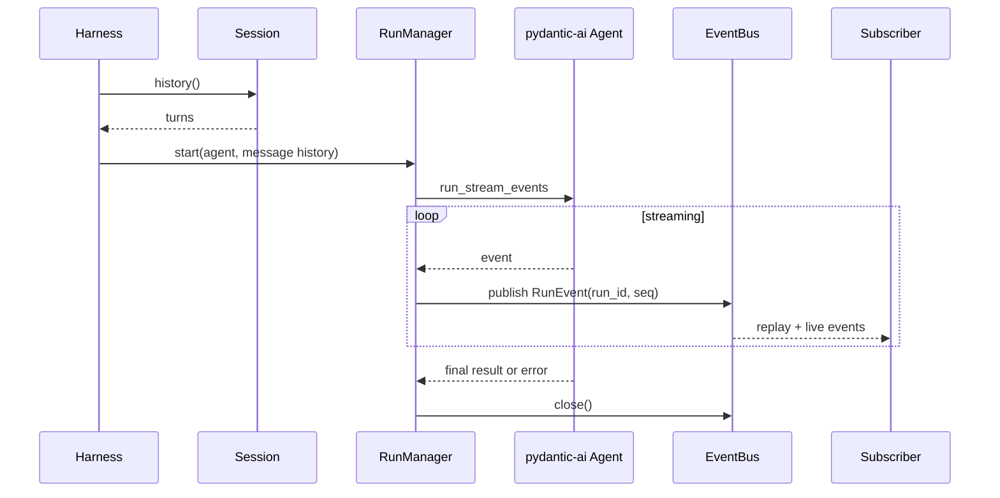
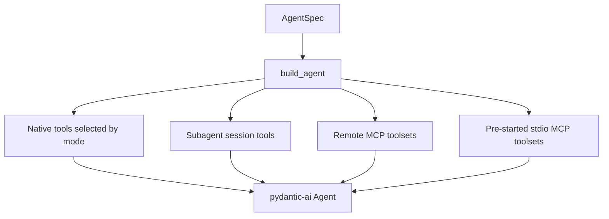
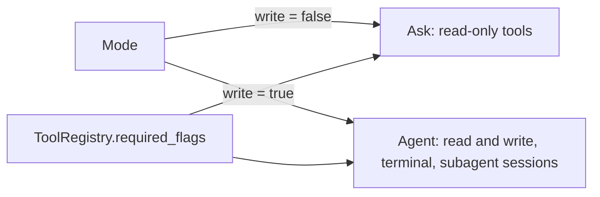

# Harness and Runtime

**Scope:** `agentbox-harness` is the pure agent runtime. It knows nothing about HTTP or the
database. This document covers its domain model, session and run mechanics, event bus,
middleware, compaction, subagent sessions, tool boxes, and LSP integration.

## Domain model

An agent definition is an `AgentSpec`. It is the harness's stable contract; the API layer
serializes it into database rows and back.

| Type | Purpose |
|---|---|
| `AgentSpec` | Name, description, instructions, model binding, tool bindings, modes |
| `ModelBinding` | The model selected for the agent |
| `Mode` | A named behavior mode with flags such as `write` |
| `NativeToolBinding` | A reference to a built-in tool by name |
| `McpToolBinding` | A remote URL or stdio MCP server binding |
| `ToolBinding` | Union of native and MCP bindings |
| `DEFAULT_MODES` | `ask` (read-only) and `agent` (write-enabled) |

Modes are the primary capability switch. `ask` exposes read-only tools; `agent` additionally
enables write tools, terminal access, and subagent-session tools. Tool registry entries declare
the flags they require, and `select_tools(mode, names)` filters accordingly.

## Sessions and the turn chain

A `Session` wraps a `MessageLogStore` and a head id. History is a parent-linked chain: each
`Turn` stores the id of its parent, and `Session.history()` walks backward from the head until a
`summary` turn or the root. This makes branching structural rather than a separate table.

- `InMemoryMessageLogStore` is used in tests and ephemeral runs.
- `DatabaseMessageLogStore` (in `agentbox-models`) persists turns as `TurnRow` rows.
- A `summary` turn replaces a prefix of the chain after compaction; later reads start there.
- Forking reuses an earlier turn as the head; retry re-runs from a user turn without appending a
  duplicate user turn.

See the [data model](05-data-model.md) for how the chain is stored and queried.

## Runs and the event bus

`Harness.run` starts an asynchronous run and returns a `Run`. A run owns an `asyncio.Task` and a
`CancellationToken`. `RunManager._drive` calls `agent.run_stream_events(...)`, wraps every
pydantic-ai event as a `RunEvent(run_id, seq, event)`, and publishes it on an `EventBus`.

`EventBus` keeps a replay history and a queue per subscriber. A subscription yields events in
sequence order and ends when the bus closes. If the model raises a context-window error, the run
invokes middleware recovery; when recovery produces new history, the run retries once.

*Figure 1 — Run and event flow.*

## Harness orchestration

`Harness` wires together the spec, the resolved model, a message-log store, middleware, and the
MCP session manager. Its main methods:

- `start_session(store, head_id)` returns a `Session`.
- `run(...)` resolves the mode, runs `prepare_mcp`, appends the user turn (unless retrying),
  builds the agent, and delegates to the run manager.
- `run_turn(...)` is a blocking convenience wrapper around `run`.
- `prepare_mcp(...)` starts or reuses session-scoped stdio MCP servers and reports warnings.

*Figure 2 — Agent assembly.*

## Agent assembly and tool selection

`build_agent` is where an agent definition becomes a runnable agent:

1. Resolve the active mode and its flags.
2. Select native tool names from the spec and filter them through the `ToolRegistry`, which
   enforces required flags.
3. Add the subagent-session tool bundle in write mode: `list_agents`,
   `start_subagent_session`, `list_subagent_sessions`, `get_subagent_session`,
   `cancel_subagent_session`, `wait_subagent_session`, and `wait_subagent_sessions`.
4. Add remote MCP toolsets (rebuilt per agent build).
5. Attach already-started stdio MCP toolsets from the session-scoped manager.

*Figure 3 — Mode-based tool selection.*

## Middleware and compaction

`RunMiddleware` receives a `RunContext` and can act before a run and when recovering. The
compaction middleware is the main implementation:

- It estimates tokens with `len(content) / 4`.
- It triggers when the estimate crosses `compaction_ratio * context_window`, or when the model
  reports a context-window overflow.
- It summarizes older turns with a separate `Agent` call, inserts a `summary` turn, and rewires
  the chain so subsequent history starts at the summary.
- It keeps a configurable number of recent turns and caps the summary size.

Compaction can run proactively before a turn or reactively during overflow recovery. After a
successful recovery the run retries once.

## Subagent sessions

There is one delegation model: a session starts another session.

- An **agent** is a configuration; a **session** is a live instance; a **subagent** is the agent
  configuration chosen by a parent session for a subagent session.
- Any agent configuration in the database may be used; there is no allow-list.
- The model gets `list_agents`, `start_subagent_session`, `list_subagent_sessions`,
  `get_subagent_session`, `cancel_subagent_session`, `wait_subagent_session`, and
  `wait_subagent_sessions`.
- Subagent sessions are background sessions with their own persisted `SessionRow`, status, live
  output, and final output. Depth is capped at 3 and a parent may run at most 5 direct subagent
  sessions.
- The API layer provides `SubagentSessionManager` with live output, wait all/any, and recursive
  cancellation; see [concurrency and lifecycle](10-concurrency-and-lifecycle.md).

## Toolboxes

| Toolbox | Highlights |
|---|---|
| Filesystem | Read, write, edit, copy, move, guarded delete; tree, search, file info; media reads with Pillow downscaling; project root and extra-root path guards |
| Grep | Pure-Python content search with file/line/result/walk limits and excluded directories |
| Terminal | Global `JobManager`, max 20 jobs per session, per-job output drain, truncation, process-tree kill, configurable timeout |
| Web | Keyless search via ddgs/SearXNG; HTTPS fetch with SSRF guards, redirect revalidation, size limits, and HTML-to-Markdown extraction |

Every native tool can have post-result hooks. Two hooks are registered by the API layer: LSP
diagnostics after writes, and nested `AGENTS.md` instruction injection.

## LSP diagnostics

The `LspManager` is a process-global singleton. It detects a project's stacks (Python,
TypeScript, Rust) from marker files, starts one server per `(project_root, stack)`, and caches
failures with a backoff. After a write tool runs, a hook syncs the changed document, waits for
diagnostics to settle, and appends formatted diagnostics to the tool result. Rust uses
server-status notifications to detect quiescence instead of a fixed delay. There is no idle
eviction; servers live until shutdown.

## Implementation notes

> **Implementation note:** when a model override is supplied, `Harness.run` still constructs the
> agent with `self.model`; the override is passed only to `run_stream_events`. Treat the override
> as a run-level argument, not an agent-level one.

> **Implementation note:** the harness is protocol-agnostic by design. ACP, A2A, and AG-UI all
> consume the same `EventBus` and differ only in event mapping and persistence finishing.

## Related

- [Backend](03-backend.md)
- [Data model](05-data-model.md)
- [Protocols](07-protocols.md)
- [Concurrency and lifecycle](10-concurrency-and-lifecycle.md)
- [Index](README.md)
