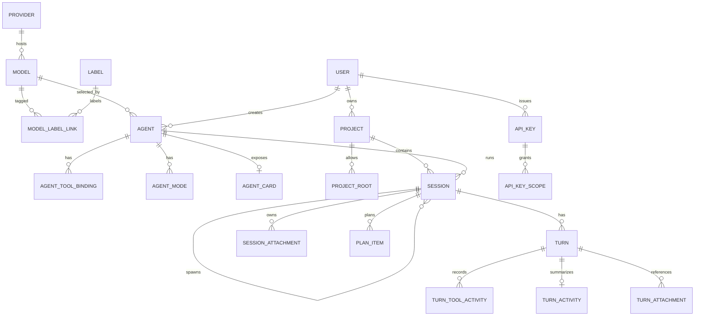

# Data Model

**Scope:** Schema v1 owned by `agentbox-models`: core/auth tables, normalized relationships, media
metadata, the turn chain, deletion behavior, and migration strategy. Class definitions live in
`packages/agentbox-models/src/agentbox_models/tables/core.py` and `tables/auth.py`.

Schema v1 is a clean reset. There is no migration path from the pre-v1 schema; delete old local
databases (`just reset-db`).

## Conventions

- Every table has an application-generated UUID hex primary key stored as `String(32)`.
- Every relationship is a real foreign key. Session-owned rows cascade; references that should
  block deletion use `RESTRICT`.
- SQLite connections enable `PRAGMA foreign_keys=ON` so behavior matches PostgreSQL and MySQL.
- Long free-form text uses `Text`; bounded fields use explicit `String(n)` lengths.
- Timestamps use timezone-aware UTC (`UTCDateTime`).
- Ordered lists have explicit `position` columns.
- No `JSON` or `LargeBinary` columns exist. Uploaded files live under the media directory; their
  metadata lives in `media_file`.

## Entity-relationship overview



## Core tables

| Table | Key columns / relationships |
|---|---|
| `provider` | `id`, `name`, `kind`, `base_url`, `api_key`, `models_url`, `is_builtin` |
| `model` | `id`, `provider_id` FK RESTRICT, `name`, `context_window` |
| `label` | `id`, `name` unique |
| `model_label_link` | `(model_id, label_id)` FK CASCADE, `priority` |
| `agent` | `id`, `name` unique, `description` Text, `instructions` Text, `model_id` FK RESTRICT, `model_label`, `avatar_file_id` FK SET NULL, `created_by` FK SET NULL, `created_at` |
| `agent_tool_binding` | `id`, `agent_id` FK CASCADE, `position`, `kind` (`native`/`mcp`), `name`, MCP fields; child tables for required flags, args, env, and env passthrough |
| `agent_mode` | `id`, `agent_id` FK CASCADE, `position`, `name`; `agent_mode_flag` stores `(mode_id, name, enabled)` |
| `agent_card` | `id`, `agent_id` unique FK CASCADE, `file_id` FK SET NULL, `updated_at`; card JSON lives in the media directory |
| `project` | `id`, `name`, `path` Text, `owner_id` FK RESTRICT, `created_at` |
| `project_root` | `id`, `project_id` FK CASCADE, `position`, `path` Text |
| `sessionrow` | `id`, `project_id` FK RESTRICT, `agent_id` FK RESTRICT, `title` Text, `parent_session_id` self-FK CASCADE, subagent status/error/output/depth, `created_at` |
| `turnrow` | `id`, `session_id` FK CASCADE, `role`, `content` Text, `parent_id` self-FK CASCADE, `context_tokens`, `created_at` |
| `turn_activity` | `turn_id` PK/FK CASCADE, `status`, `reasoning_ms`, `reasoning_text` Text, `error_code`, `error_message` Text |
| `turn_tool_activity` | `id`, `turn_id` FK CASCADE, `position`, `name`, `status`, `duration_ms`, `args` Text, `result` Text |
| `session_attachment` | `id`, `session_id` FK CASCADE, `file_id` FK media_file CASCADE, `filename` Text, `created_at` |
| `turn_attachment` | `(turn_id, attachment_id)` FKs CASCADE, `position` |
| `planitem` | `id`, `session_id` FK CASCADE, `position`, `content` Text, `status`, timestamps |
| `media_file` | `id`, `storage_path` unique, `media_type`, `size_bytes`, `sha256`, `created_at` |

## Auth tables

| Table | Key columns / relationships |
|---|---|
| `user` | `id`, `username`, `email`, `password_hash`, `is_active`, `created_at` |
| `role` | `id`, `name`, `description` |
| `permission` | `id`, `name`, `description` |
| `rolepermissionlink` | `(role_id, permission_id)` FKs CASCADE |
| `userrolelink` | `(user_id, role_id)` FKs CASCADE |
| `apikey` | `id`, `user_id` FK CASCADE, `key_hash`, `expires_at`, `revoked_at`, `created_at` |
| `apikey_scope` | `(api_key_id, scope)` PK, `api_key_id` FK CASCADE |

## Media storage

- Bytes live under the configured `media_dir`:
  - `avatars/{media_id}.png`
  - `attachments/{media_id}{suffix}`
  - `agent-cards/{media_id}.json`
- `media_file.storage_path` is relative and POSIX-style.
- Writes are atomic and record SHA-256 and size.
- Upload writes the file first, then the DB rows; a failed transaction removes the new file.
- Delete removes DB rows and then files; missing files are logged and tolerated.
- Session deletion collects attachment files before cascades remove the rows.

## Turn chain and branching

`turnrow.parent_id` defines an immutable chain. The session leaf is the turn that no other turn
references as a parent. History is read by walking parents from the leaf.

- **Fork:** point the new turn's parent at an earlier turn.
- **Retry:** start from the user turn preceding a failed assistant turn.
- **Summary:** compaction inserts a `summary` turn and points the next user turn at it.

## Deletion and cascades

- Deleting a session cascades to turns, turn activity/tools, turn links, attachments, plan items,
  and child sessions.
- Deleting an agent cascades to its bindings, modes, and card; sessions referencing the agent use
  `RESTRICT`.
- Models/providers/projects in use are `RESTRICT`; API routers return `409 Conflict`.
- Users cascade to API keys and role links; project ownership is `RESTRICT` and
  `agent.created_by` is `SET NULL`.
- Session cleanup also closes MCP toolsets, kills terminal jobs, clears instruction state, and
  cancels subagent sessions before deleting rows.

## Migrations

Schema v1 has a single initial Alembic revision
(`packages/agentbox-models/alembic/versions/cb4176fc9480_initial_schema_v1.py`). The historical
chain was deleted. Alembic reads the shared TOML/env resolver and supports async URLs.

```powershell
uv run alembic -c packages/agentbox-models/alembic.ini upgrade head
just reset-db
```

The dev server still uses `SQLModel.metadata.create_all`, which does not alter existing databases
but does add tables missing from an older database. The plugin-state migration therefore skips
tables and indexes that `create_all` already created, so `just dev` upgrades a drifted local
database cleanly. A metadata-diff test guards the migrations against model drift.

## Related

- [Harness and runtime](04-harness-runtime.md)
- [Auth and security](06-auth-and-security.md)
- [Concurrency and lifecycle](10-concurrency-and-lifecycle.md)
- [Index](README.md)
