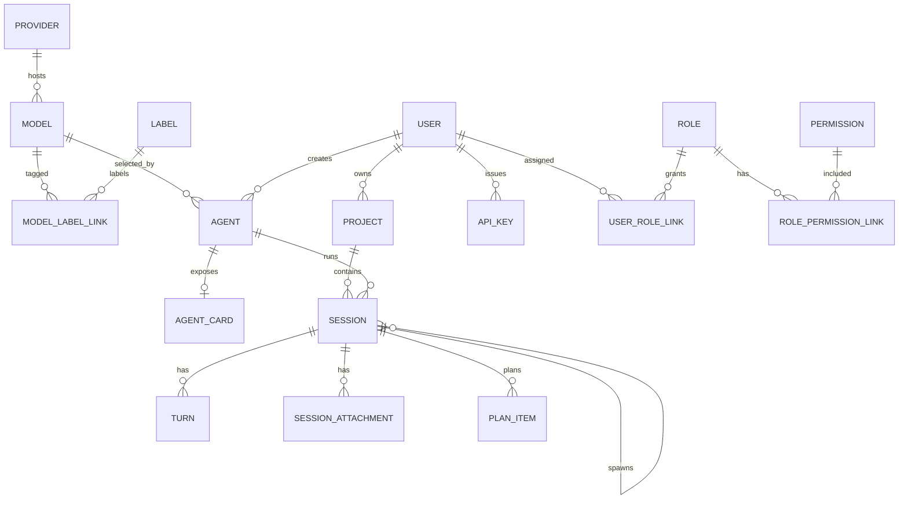
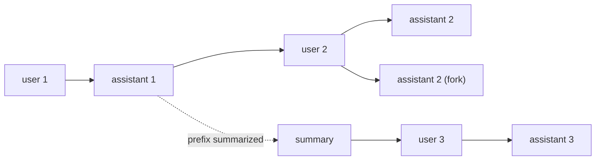

# Data Model

**Scope:** The SQLite schema owned by `agentbox-models`: core and auth tables, relationships,
column encodings, the turn chain, deletion behavior, and the migration strategy. Class definitions
live in `packages/agentbox-models/src/agentbox_models/tables/core.py` and `tables/auth.py`.

## Conventions

- Every table has a string primary key containing a UUID hex value.
- There are no SQLAlchemy `relationship()` definitions and no database cascades. Joins, ordering,
  and deletes are explicit in repositories and the API layer.
- Foreign-key columns declare `foreign_key=` for documentation and migration purposes, but
  referential integrity is maintained by application code.
- Some columns hold opaque JSON text; others use a real JSON column. See
  [column encoding rules](#column-encoding-rules).

## Entity-relationship overview

*Figure 1 — Entity-relationship overview.*



## Core tables

### Provider

An LLM provider configuration.

| Column | Notes |
|---|---|
| `id` | Primary key |
| `name` | Display name |
| `kind` | Resolver key (`openai_legacy`, `openai_responses`, `anthropic`, `generic`, `moonshot`, `deepseek`, `ollama`, test kinds) |
| `base_url` | API base URL |
| `api_key` | Stored plaintext; falls back to `{NAME}_API_KEY` when empty |
| `models_url` | Endpoint used by model discovery |
| `is_builtin` | Marks seeded providers |

### Model

A model discovered or configured under a provider.

| Column | Notes |
|---|---|
| `id` | Primary key |
| `provider_id` | References `provider.id` |
| `name` | Model identifier sent to the provider |
| `context_window` | Token budget used by compaction |

### Label

A stable routing label (for example a capability or cost tier).

| Column | Notes |
|---|---|
| `id` | Primary key |
| `name` | Indexed, unique |

### ModelLabelLink

Many-to-many link between models and labels.

| Column | Notes |
|---|---|
| `model_id` | Part of the composite primary key |
| `label_id` | Part of the composite primary key |
| `priority` | Lower wins during label resolution |

### Agent

An agent definition. Bindings and modes are JSON text.

| Column | Notes |
|---|---|
| `id` | Primary key |
| `name` | Unique display name used in routes |
| `description` | Short intent summary |
| `instructions` | System prompt (may contain Jinja) |
| `model_id` | Direct model reference |
| `model_label` | Optional label preference overriding `model_id` at load time |
| `tool_bindings` | JSON text list of native/MCP bindings |
| `mode_definitions` | JSON text list of modes |
| `sub_agent_ids` | JSON text list of agent ids |
| `avatar_url` | Optional external avatar URL |
| `avatar_data`, `avatar_media_type` | Uploaded normalized avatar bytes and MIME type |
| `created_by` | References `user.id` |
| `created_at` | Creation timestamp |

### AgentCard

The A2A agent card for agents exposed over A2A.

| Column | Notes |
|---|---|
| `id` | Primary key |
| `agent_id` | References `agent.id` |
| `card` | JSON text of the A2A card |

### Project

A local folder that owns sessions.

| Column | Notes |
|---|---|
| `id` | Primary key |
| `name` | Display name |
| `path` | Absolute project root |
| `owner_id` | References `user.id` |
| `extra_roots` | Real JSON array of additional allowed roots |
| `created_at` | Creation timestamp |

### SessionRow

Binds an agent to a project and holds session and sub-session state.

| Column | Notes |
|---|---|
| `id` | Primary key; the public session id |
| `project_id` | References `project.id` |
| `agent_id` | References `agent.id` |
| `title` | Display title, auto-generated on first message |
| `head_turn_id` | Legacy column; current code derives the leaf from turns |
| `parent_session_id` | Self-reference for sub-sessions |
| `sub_session_status` | `running`, `completed`, `failed`, `cancelled`, or null |
| `sub_session_error`, `sub_session_output` | Sub-session result fields |
| `sub_session_depth` | Nesting depth |
| `created_at` | Creation timestamp |

### TurnRow

One message in a session's parent-linked history.

| Column | Notes |
|---|---|
| `id` | Primary key |
| `session_id` | References `sessionrow.id` |
| `role` | `user`, `assistant`, or `summary` |
| `content` | Message text |
| `parent_id` | String id of the previous turn; deliberately not a foreign key |
| `context_tokens` | Token usage reported for an assistant turn |
| `created_at` | Creation timestamp |
| `activity` | Real JSON summary of reasoning and tool activity |
| `attachments` | Real JSON list of attachment metadata |

### SessionAttachment

Uploaded file bytes for a session.

| Column | Notes |
|---|---|
| `id` | Primary key |
| `session_id` | References `sessionrow.id` |
| `media_type`, `filename` | Content type and original name |
| `data` | Binary payload |
| `created_at` | Creation timestamp |

### PlanItem

A TODO-style plan entry for a session.

| Column | Notes |
|---|---|
| `id` | Primary key |
| `session_id` | References `sessionrow.id`, indexed |
| `position` | Ordering within the plan |
| `content` | Item text |
| `status` | `pending`, `in_progress`, `completed` |
| `created_at`, `updated_at` | Timestamps |

## Auth tables

### User

| Column | Notes |
|---|---|
| `id` | Primary key |
| `username`, `email` | Identity fields |
| `password_hash` | bcrypt hash |
| `is_active` | Intended account flag (see implementation note) |
| `created_at` | Creation timestamp |

### Role

| Column | Notes |
|---|---|
| `id` | Primary key |
| `name`, `description` | Role identity |

### Permission

| Column | Notes |
|---|---|
| `id` | Primary key |
| `name` | `resource:action`, for example `agents:create` |
| `description` | Human-readable explanation |

### RolePermissionLink

| Column | Notes |
|---|---|
| `role_id`, `permission_id` | Composite primary key |

### UserRoleLink

| Column | Notes |
|---|---|
| `user_id`, `role_id` | Composite primary key |

### ApiKey

| Column | Notes |
|---|---|
| `id` | Primary key |
| `user_id` | References `user.id` |
| `key_hash` | SHA-256 hex; the raw key is never stored |
| `scopes` | JSON text list of permission names |
| `expires_at` | Optional expiry |
| `revoked_at` | Soft-revocation timestamp |
| `created_at` | Creation timestamp |

## Column encoding rules

| Encoding | Columns | Notes |
|---|---|---|
| Real JSON | `Project.extra_roots`, `TurnRow.activity`, `TurnRow.attachments` | SQLite JSON column type; queryable by the application |
| JSON-encoded text | `Agent.tool_bindings`, `Agent.mode_definitions`, `Agent.sub_agent_ids`, `AgentCard.card`, `ApiKey.scopes` | Parsed by repositories; opaque to SQL |
| Binary | `Agent.avatar_data`, `SessionAttachment.data` | Normalized image bytes and uploaded files |

## Turn chain and branching

`TurnRow.parent_id` defines an immutable chain. The session leaf is the turn that no other turn
references as a parent. History is read by walking parents from the leaf.

- **Fork:** set the new turn's parent to an earlier turn; the old suffix becomes an unreachable
  branch.
- **Retry:** start from the user turn preceding a failed assistant turn without appending a
  duplicate user turn.
- **Summary:** compaction inserts a `summary` turn and points the next user turn at it, replacing
  the prefix.

*Figure 2 — Turn chain with a summary and a fork.*



## Deletion and cascades

There are no database cascades. Session deletion goes through
`agentbox_api.runtime.delete_session_data`, which:

1. Closes the session-scoped MCP toolsets.
2. Clears project-instruction state for the session.
3. Kills terminal jobs for the session.
4. Cancels active sub-sessions.
5. Recursively deletes child sessions.
6. Deletes turns, attachments, plan items, and finally the session row.

Project deletion removes its sessions through the same path. Agent and provider deletes are
guarded in their routers (for example, a provider in use cannot be deleted).

## Migrations

The development server uses `SQLModel.metadata.create_all`, which creates missing tables but
does not alter existing ones. Schema evolution therefore requires Alembic migrations in
`packages/agentbox-models/alembic/versions/`. Apply them with:

```powershell
uv run alembic -c packages/agentbox-models/alembic.ini upgrade head
```

Current revisions, in order: initial schema, agent avatar, project extra roots, compaction
context fields, sub-sessions, model labels, chat activity, plan items, session attachments, and
session title. Alembic uses its own sync URL from `alembic.ini`, independent of the app's async
`DATABASE_URL`.

## Implementation notes

> **Implementation note:** `SessionRow.head_turn_id` is effectively legacy. Message reads and
> chat resume both derive the newest leaf by inspecting `TurnRow.parent_id`; current code does
> not maintain the stored value.

> **Implementation note:** `Provider.api_key` is stored in plaintext and returned only through
> guarded admin flows. Provider resolution falls back to environment variables when the stored
> key is empty.

> **Implementation note:** `User.is_active` exists but the authentication backend does not check
> it. Deactivation must be enforced elsewhere or added to the backend.

## Related

- [Harness and runtime](04-harness-runtime.md)
- [Auth and security](06-auth-and-security.md)
- [Concurrency and lifecycle](10-concurrency-and-lifecycle.md)
- [Index](README.md)
