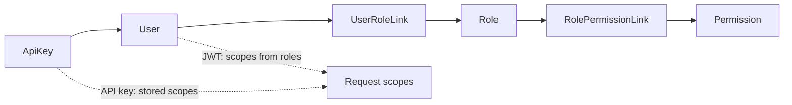
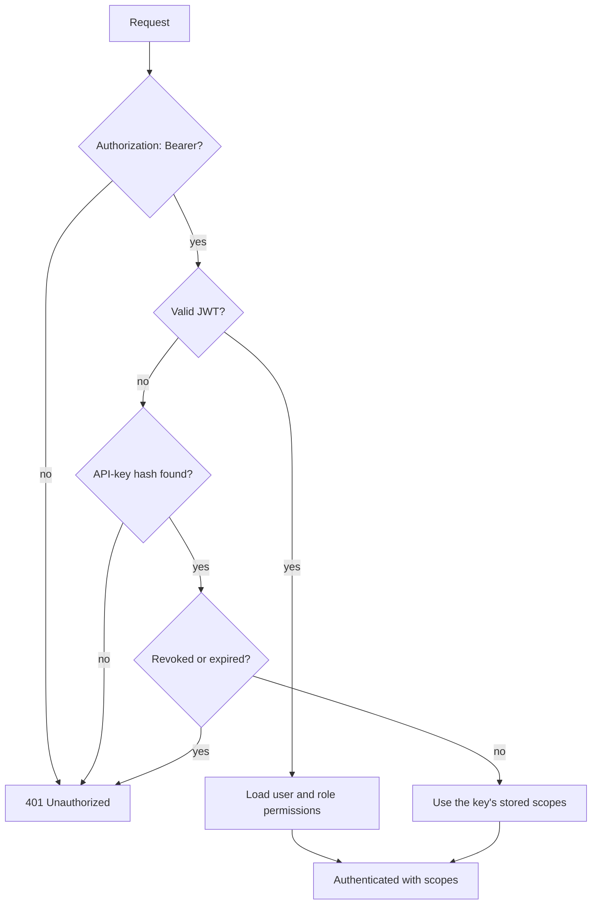

# Auth and Security

**Scope:** Identity and authorization: the RBAC tables, the authentication backend for JWTs and
API keys, the permission dependency used by routers, token and key handling, A2A
authentication, and the guardrails that bound filesystem and network access.

## RBAC model

Agentbox uses classic role-based access control: users hold roles, roles hold permissions, and
every routed action requires a permission name in the form `resource:action`.

*Figure 1 — RBAC relationships.*



The development seed defines the permission set: `agents:*`, `providers:*`, `projects:*`,
`sessions:*`, `users:manage`, `roles:manage`, and `api_keys:manage`. Administrators are users
whose roles include the management permissions; there is no special-cased superuser.

## Authentication middleware

`create_app` installs Starlette's `AuthenticationMiddleware` with
`JWTAuthenticationBackend`. For every request the backend resolves an authenticated user and a
scope list.

*Figure 2 — Authentication decision flow.*



The JWT path is tried first. A successful decode loads the user and computes effective
permissions from the user's roles. If JWT decoding or user lookup fails, the token is treated as
a candidate API key: it is SHA-256 hashed and matched against `ApiKey.key_hash`. Revoked and
expired keys are rejected. API-key requests use the key's own scopes rather than the user's role
permissions, which is what makes scope-subset keys possible.

## Authorization

Routers authorize with a dependency factory:

```python
def require_permission(name: str):
    async def checker(request: Request):
        if not request.user.is_authenticated:
            raise HTTPException(status_code=401, detail="Unauthorized")
        scopes = request.auth.scopes if request.auth is not None else []
        if name not in scopes:
            raise HTTPException(status_code=403, detail="Forbidden")
        return request.user
    return checker
```

Every protected endpoint declares `Depends(require_permission("resource:action"))`. The A2A
dispatcher performs the equivalent check manually because it is a mounted ASGI app rather than a
FastAPI route.

> **Implementation note:** authorization is server-side only. The frontend hides navigation items
> based on the user's permissions, but a direct URL still reaches the page and the backend decides
> whether the request succeeds. Do not treat the UI as a security boundary.

## Tokens and secrets

| Credential | Creation | Storage | Lifetime |
|---|---|---|---|
| Password | User registration/admin create | bcrypt hash in `User.password_hash` | Until changed |
| JWT | `POST /auth/login` | Client-held bearer token | `jwt_expiry_seconds` (default 1 hour) |
| API key | `POST /api-keys` | SHA-256 hex in `ApiKey.key_hash`; raw value returned once | Optional `expires_at`, soft revoke |

JWT payloads use `sub` (the user id) and `exp`, signed with `jwt_algorithm` (HS256 by default)
and the configured `jwt_secret`, which must be at least 32 characters. API keys are generated
with `secrets.token_urlsafe(32)`. When a key is created, the requested scopes must be a subset of
the caller's current scopes; revocation sets `revoked_at` instead of deleting the row.

## A2A authentication

The `/a2a` mount sits inside the authenticated application, so A2A requests pass through the same
backend. The dispatcher requires an authenticated user and the `sessions:create` scope before
resolving the agent's card and delegating to the per-agent JSON-RPC app. The authenticated user
id is propagated to the executor through a context variable so that created sessions belong to
that user.

## Sandboxing and guardrails

| Surface | Guardrail |
|---|---|
| Filesystem tools | `resolve_project_path` rejects paths that escape the project root or its `extra_roots`; deletes are guarded |
| MCP Apps | App iframes load through `/sandbox`, which computes a CSP and proxies resource/tool traffic through the backend |
| Web fetch | HTTPS-only with SSRF checks, redirect revalidation, response-size limits, and a configurable user agent |
| Media | Image reads are downscaled to configured dimensions and byte limits |
| Sub-sessions | Concurrency and depth caps limit runaway delegation |

## Security notes and limitations

> **Implementation note:** provider API keys are stored in plaintext in `Provider.api_key`.
> Protect the database file and prefer environment-variable keys where possible.

> **Implementation note:** `User.is_active` is stored but not checked by the authentication
> backend; an inactive user with a valid token can still authenticate until that check is added.

> **Implementation note:** the ACP adapter falls back to a hardcoded development JWT secret when
> `JWT_SECRET` is not set. Set `JWT_SECRET` for any shared or persistent environment.

> **Implementation note:** A2A task state is held in memory in the per-agent handler, so A2A task
> bookkeeping does not survive a process restart even though Agentbox sessions and turns do.

## Related

- [Data model](05-data-model.md)
- [Backend](03-backend.md)
- [Protocols](07-protocols.md)
- [Index](README.md)
