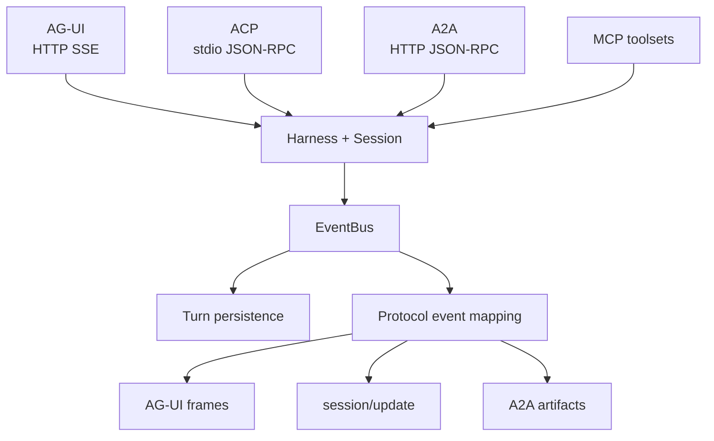
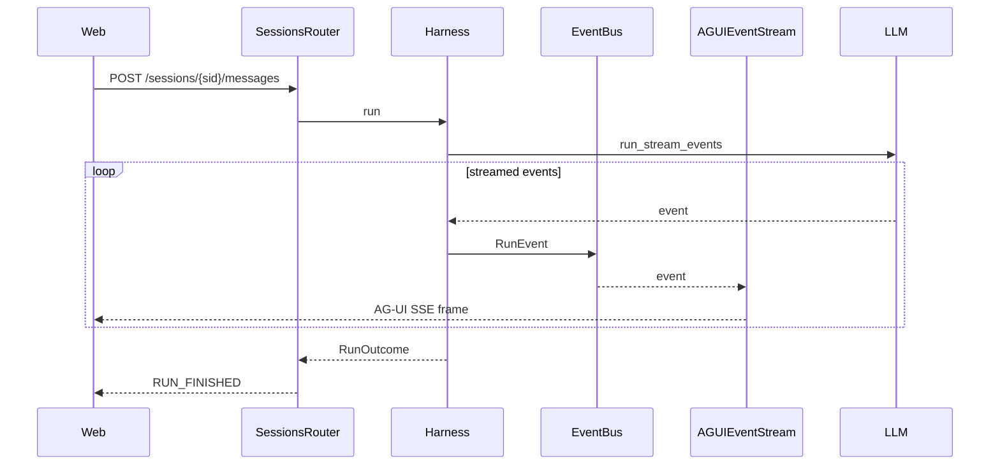
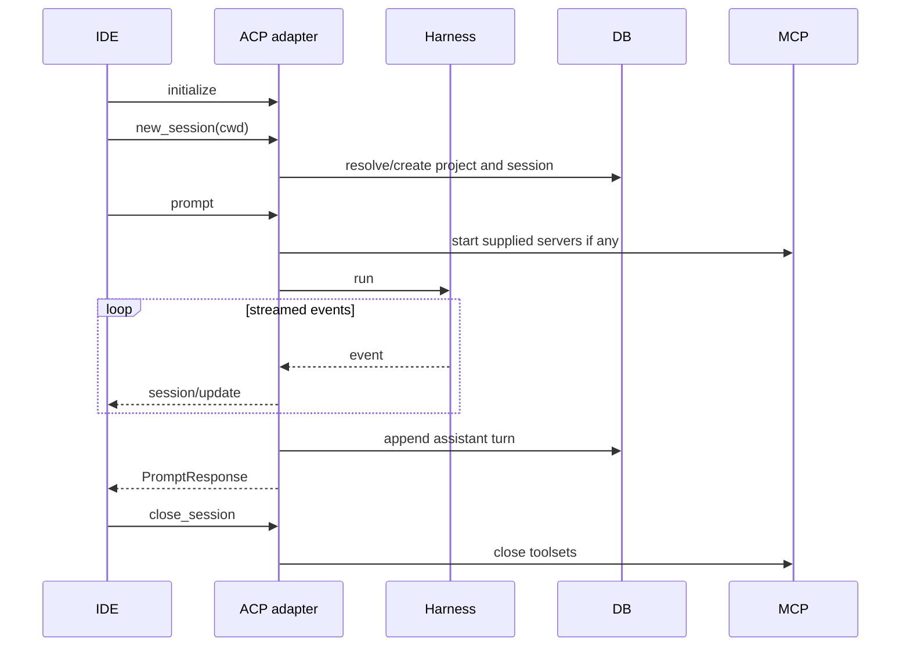
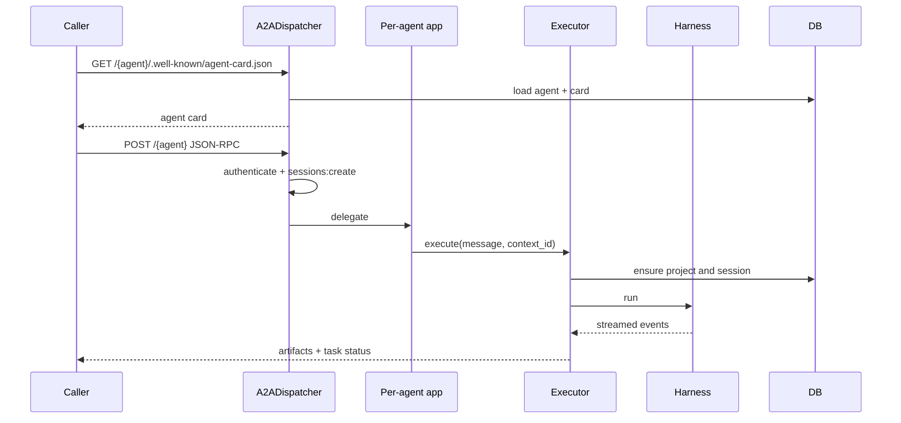
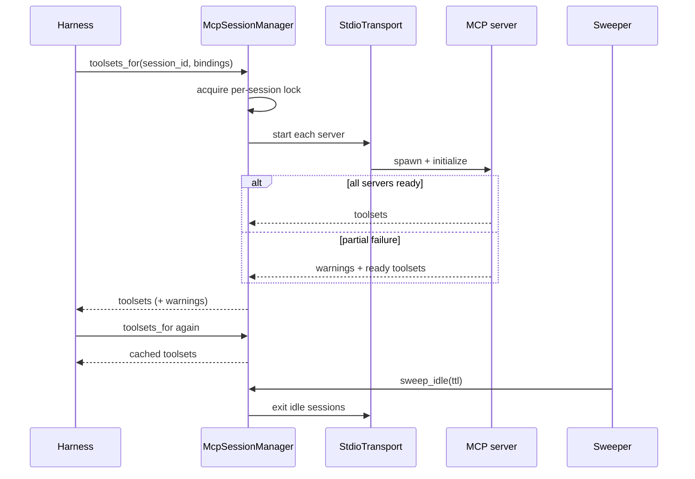

# Protocols

**Scope:** The four protocol surfaces that drive the same agent runtime: AG-UI for the web UI,
ACP for IDEs over stdio, A2A for agent-to-agent calls over HTTP, and MCP for external tools and
resources. Each section describes transport, authentication, event mapping, and lifecycle.

## Shared harness pattern

Every protocol follows the same shape: resolve an `AgentSpec` and model, construct a harness
`Session`, run it, and consume the run's `EventBus`. The protocol adapter maps pydantic-ai and
harness events into its wire format and persists the assistant turn when the run completes.
Protocols differ in transport, authentication, persistence finishing, and process model, not in
agent behavior.

*Figure 1 — Protocol-to-harness mapping.*

## AG-UI

The web UI streams a run over server-sent events.

- Endpoint: `POST /sessions/{sid}/messages` returns `text/event-stream`.
- Adapter: `agentbox_api.streaming` wraps the event stream in
  `pydantic_ai.ui.ag_ui.AGUIEventStream` and returns an SSE response.
- Events: pydantic-ai runs are translated into AG-UI event types (`TEXT_MESSAGE_*`,
  `REASONING_MESSAGE_*`, `TOOL_CALL_*`, `RUN_STARTED`, `RUN_FINISHED`, `RUN_ERROR`, and activity
  snapshots).
- Custom events: MCP startup failures are emitted as `CustomEvent` subclasses named
  `mcp.warning`, before run events.
- Persistence: a separate `finish()` task appends the assistant turn when the run outcome is
  known.

*Figure 2 — AG-UI over HTTP.*

## ACP

ACP lets an external IDE drive sessions over stdin/stdout JSON-RPC.

- Entry points: the `agentbox-acp` console script and `python -m agentbox_api.acp_server`.
- Server: `AgentboxAcpAgent` implements initialize, new/load/resume/delete/close session, prompt,
  cancel, and set-mode.
- Session cache: per process, keyed by ACP session id, holding the spec, model, registry, mode,
  active run, and extra roots.
- Prompt flow: build a harness `Session` from the latest leaf, run the harness, map events with
  `update_for_event` into `session/update` payloads, then append the assistant turn.
- MCP: ACP clients may supply stdio MCP servers; `_with_servers` adds them to the spec.
- Shutdown: `close_session` closes MCP toolsets, kills terminal jobs, recursively cancels
  descendant subagent sessions, and cancels the active run.
- Persistence: the same SQLite database as HTTP; the ACP process opens its own engine.

*Figure 3 — ACP over stdio.*

## A2A

A2A exposes selected agents to other agents or services.

- Mount: `app.mount("/a2a", A2ADispatcher(...))`.
- Routing: the dispatcher strips `/a2a`, parses `/{agent_name}/...`, authenticates, checks
  `sessions:create`, and requires a stored `AgentCard` (otherwise 404).
- Per-agent app: a lazily created Starlette app using `DefaultRequestHandler` with
  `InMemoryTaskStore`, plus agent-card and JSON-RPC routes.
- Card: `build_card` parses the stored JSON, forces streaming, and rewrites
  `supported_interfaces` to `{a2a_public_url}/a2a/{agent_name}`.
- Execution: `AgentboxA2AExecutor` maps `task.context_id` to an Agentbox session id, works under
  `a2a_workspace`, streams text into artifacts, and completes or fails the task.
- Cancellation: the executor cancels the run tracked for that context id.

*Figure 4 — A2A over HTTP.*

## MCP

MCP supplies external tools and resources. Agentbox supports two binding types.

**Remote URL (streamable HTTP).** The toolset is constructed on every agent build and is not
cached by the session manager. It is ephemeral and reconnects as needed.

**stdio.** A local process is started from `command`, `args`, `env`, and `cwd`. These processes
are expensive, so they are session-scoped:

- `McpSessionManager` is a process-global singleton.
- Toolsets are cached per Agentbox session id, behind a per-session `asyncio.Lock`.
- All servers for a session start concurrently with a configured start timeout.
- A failed server produces a `McpWarning` instead of failing the turn.
- `sweep_idle(ttl)` closes sessions that have not been used recently; the app lifespan runs it on
  an interval.
- `close_session` and `close_all` exit toolsets; they are called on session deletion, ACP close,
  and app shutdown.

*Figure 5 — MCP stdio toolset lifecycle.*

### MCP Apps

MCP servers can return app content that the UI renders in a sandboxed iframe. The backend is the
only network path for the app: the web client posts to
`POST /sessions/{sid}/mcp/{server_id}/resources/read` and `/tools/call`, and the backend reuses
the session's cached stdio toolset or opens an ephemeral remote toolset. `/sandbox` serves the
proxy page and computes its CSP.

## Protocol comparison

| Protocol | Transport | Auth | Persistence | Lifecycle | Concurrency |
|---|---|---|---|---|---|
| AG-UI | HTTP SSE | Bearer JWT or API key | Same process as API | Per-request stream; run tracked by session | One active run per session |
| ACP | stdio JSON-RPC | Local process; optional MCP servers from client | Own engine, same database | Per-process session cache | One run per ACP session |
| A2A | HTTP JSON-RPC | Bearer JWT or API key with `sessions:create` | Same process as API; in-memory task store | Per-agent app cached in dispatcher | Runs tracked per context id |
| MCP | HTTP or stdio | Provider/process environment | Toolset lives for the session | Session-scoped cache with idle sweep | Per-session lock; concurrent start |

## Implementation notes

> **Implementation note:** stdio MCP bindings are captured when a session's toolsets start.
> Editing an agent's MCP bindings does not restart toolsets for an existing session; they are
> reused until the session is closed or idle-swept.

> **Implementation note:** A2A task state is in memory. A restart loses A2A task bookkeeping but
> keeps the Agentbox sessions and turns.

> **Implementation note:** the frontend parses the AG-UI SSE stream itself. `@ag-ui/client` is a
> dependency, but the client's agent abstraction is not used.

## Related

- [Harness and runtime](04-harness-runtime.md)
- [Backend](03-backend.md)
- [Auth and security](06-auth-and-security.md)
- [Concurrency and lifecycle](10-concurrency-and-lifecycle.md)
- [Index](README.md)
