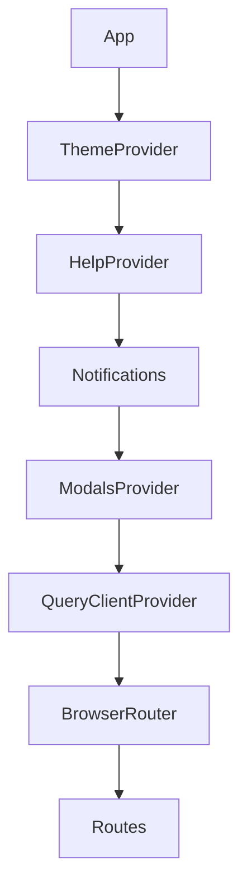
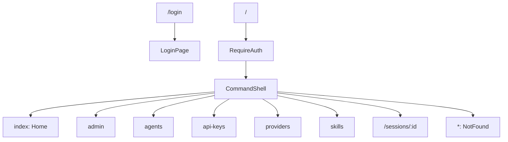
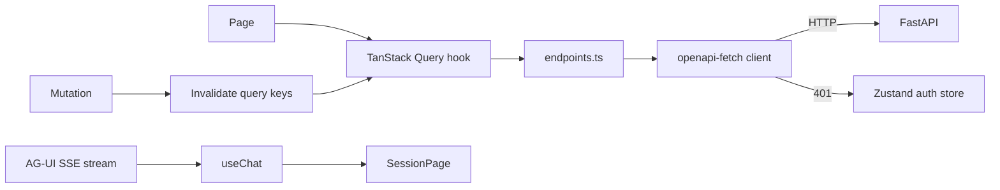

# Frontend

**Scope:** The React application in `apps/web`: build and tooling, provider and routing
composition, the design-system shell, the typed API layer, client state, theming, pages, and help
and onboarding surfaces. Chat behavior is covered in
[Chat and streaming](09-chat-and-streaming.md).

## Build and tooling

- **Vite** serves the app on port 5173. The dev proxy matches `^/api/` and forwards to
  `http://localhost:8000`, stripping the `/api` prefix. It also forwards `^/llms\.txt$` and
  `^/llms/` without rewriting so the public agent guide resolves at the browser origin. In
  production the same relative paths are served by whatever host fronts the API.
- **TypeScript** is strict with `noEmit`; imports are relative (there are no path aliases).
  `bun run build` runs `tsc --noEmit` before `vite build`.
- **Environment:** `src/config.ts` is the single access point. `VITE_API_URL` defaults to
  `/api`; `VITE_SANDBOX_URL` defaults to `http://localhost:8000/sandbox`.
- **Storybook** collects stories from `design-system`, `chat`, `help`, `onboarding`, and `pages`.
  It provides dark/light and viewport globals and treats accessibility violations as errors.
- **Vitest** uses jsdom, `src/test/setup.ts`, and `src/test/render.tsx`
  (`renderWithTheme`, dark by default). Tests are colocated `*.test.ts(x)` under `src`.
- **Playwright** lives in `apps/web/e2e` and starts stub servers plus the backend and Vite; see
  [testing and observability](11-testing-and-observability.md).
- **Generated types:** `src/api/schema.d.ts` comes from `openapi.json` and is never hand-edited.

## Application composition

The provider stack is deliberately shallow so every route shares the same theme, help registry,
notifications, query cache, and router.

*Figure 1 — Provider tree.*



- `ThemeProvider` wraps Mantine and keeps `data-theme` in sync with the active scheme.
- `HelpProvider` exposes contextual help to every route, including login.
- `Notifications` and `ModalsProvider` are mounted app-wide.
- `QueryClientProvider` uses a single module-scoped client with a conservative retry policy.
- `BrowserRouter` owns routes; there are no data-router loaders or actions.

## Routing and shell

*Figure 2 — Route tree.*



`RequireAuth` checks the Zustand auth store for a token and redirects to `/login`, preserving the
intended location. `CommandShell` renders navigation based on the user's permissions: Home,
Agents, Providers, Skills, API keys (`api_keys:manage`), and Admin (`roles:manage` or
`users:manage`). A direct URL to a hidden page still renders; the backend enforces access.

The desktop shell is a three-column grid: a 56px icon rail, a 280px project/session panel, and
the workspace. Below 1100px it becomes a mobile shell; below 768px the project panel becomes a
sheet. `Workspace` switches to a full-height, non-scrolling layout on `/sessions/:id`, and
`PageContainer` provides either a centered max-width container or full-bleed content.

## API layer

| File | Role |
|---|---|
| `src/api/client.ts` | `openapi-fetch` client, bearer-token middleware, 401 handling, network-error wrapping |
| `src/api/endpoints.ts` | One typed function per backend operation, plus schema-derived type aliases |
| `src/api/queries.ts` | TanStack Query hooks, polling, and mutation invalidation |
| `src/api/queryClient.ts` | Single `QueryClient` and retry policy |
| `src/api/errors.ts` | `ApiError` and FastAPI `detail` normalization |
| `src/api/schema.d.ts` | Generated path/component types |

The client is created once with `baseUrl = API_URL`. Auth middleware reads the token directly
from the Zustand store. Response middleware clears the store on any 401, which makes `RequireAuth`
redirect. Network failures become `ApiError` with status 0. Multipart uploads and attachment
downloads bypass the typed client because `openapi-fetch` is not used for them; they attach the
bearer token manually.

`toApiError` extracts a string `detail` or joins FastAPI validation messages and builds a field
map from `loc`. Forms use `ApiError.fields` to attach errors to inputs. The query client retries
at most once, and only for network errors or 5xx responses; 4xx never retries.

*Figure 3 — Frontend data flow.*



## State management

- **Server state** lives in the TanStack Query cache. Query keys follow `[resource]` or
  `[resource, id]`; examples include `["projects"]`, `["sessions"]`, `["agents"]`,
  `["messages", sid]`, `["session", sid]`, `["session-plan", sid]`, and
  `["session-files", sid, q]`. Mutations invalidate affected prefixes rather than writing the
  cache optimistically.
- **Auth state** is a Zustand store persisted to `sessionStorage` under `agentbox-auth`
  (`token`, `user`, `permissions`). A 401 clears it.
- **Ephemeral UI state** is local component state: chat segments, composer text, form drafts,
  split-pane width, onboarding step, and the active help entry.
- **The event bus** (`src/lib/bus.ts`) is a typed `mitt` emitter with a single declared event,
  `theme:changed`. Theme changes currently go through Mantine directly.

Browser storage keys: `agentbox-auth` (session storage), `agentbox-color-scheme` (local
storage, Mantine), and `agentbox-onboarding-v1` (local storage, onboarding dismissal).

## Design system

The design system is layered:

```
tokens (CSS custom properties)
  → theme (Mantine theme + data-theme sync)
  → primitives / forms / data / overlays / navigation / icons
  → patterns (page-level compositions)
  → shell (application chrome)
```

- **Tokens:** `tokens.css` defines `--ab-*` fonts, text sizes, spacing, radii, motion, layout
  constants, z-index, and dark/light semantic colors. Dark is the design baseline; runtime
  defaults to the system preference.
- **Theme:** `theme.ts` maps Mantine colors and fonts to tokens. `ThemeProvider` persists the
  scheme and writes `document.documentElement.dataset.theme`; `ThemeToggle` switches it.
- **Styles:** `layers.css` declares `@layer reset, legacy, ds, utilities`; global rules live in
  `@layer ds`. CSS Modules are unlayered and therefore override global rules. There is no
  Tailwind or CSS-in-JS.
- **Primitives and patterns:** `Button`, `Panel`, `StatusChip`, `PageHeader`, `EmptyState`,
  forms, `DataTable`, `ConfirmDialog`, `Modal`, `Drawer`, `ListPage`, `SettingsPage`,
  `AdminTablePage`, `GuidedEmptyState`, and `ErrorState`.
- **Icons:** `Icon` is decorative unless a label is provided; `IconButton` requires a label and
  shows a tooltip. This is the convention for icon-only actions.

## Pages

| Page | Responsibility | Backend APIs |
|---|---|---|
| `HomePage` | Dashboard, project/session overview, onboarding entry | `GET /projects`, `/sessions`, `/agents`, `/providers`, `/models`; onboarding creates provider, models, agent, project, session |
| `SessionPage` | Chat surface, plan, about/LSP, attachments, MCP apps | `GET /sessions/{sid}`, `/messages`, `/lsp`, `/plan`; `PATCH /sessions/{sid}`; chat stream and cancel; attachments; files; skills; MCP relay; avatar |
| `AgentsPage` | Agent CRUD, tools/modes/MCP editors, A2A card, prompt preview | `/agents`, avatar and card subroutes, `/prompts/preview`, `/models`, `/providers`, `/labels` |
| `ProvidersPage` | Provider CRUD and connection test, model list and labels | `/providers`, `/providers/test`, `/providers/{id}/models/refresh`, `/models`, `/labels` |
| `SkillsPage` | User skill browse/create/edit/delete | `/skills`, `/skills/{name}` |
| `AdminPage` | Permissions, roles, users, assignments | `/permissions`, `/roles`, `/users`, assignment subroutes |
| `ApiKeysPage` | Create/list/revoke scoped keys | `/api-keys`, available scopes from `auth/me` |
| `LoginPage` | Login and redirect | `POST /auth/login`, `GET /auth/me` |
| `NotFoundPage` | Unknown authenticated route | — |

Subagent sessions are managed through model tools; there is no dedicated child-session browser
or agent-form subagent picker in the web UI.

## Help and onboarding

- **Help registry:** `src/help/types.ts` defines 16 `HelpId`s across providers, agents, A2A, API
  keys, skills, and onboarding. `src/help/content.ts` holds the entries. `HelpProvider` exposes
  `openHelp`; `HelpDrawer`, `HelpTip`, and `HelpLink` render full entries, popovers, and inline
  links. Help state is not persisted.
- **Onboarding:** progress is derived from counts (provider, model, agent, session). The wizard
  walks welcome → provider → agent → session → done, creating real records through the API.
  `HomeChecklist` summarizes progress and resumes at the next step. Dismissal persists under
  `agentbox-onboarding-v1`.

## Implementation notes

> **Implementation note:** `@mantine/modals`' imperative API is not used; destructive actions use
> the local `ConfirmDialog`. `ModalsProvider` is mounted but currently only provides context.

> **Implementation note:** the `mitt` bus is declared but has no production publisher or
> subscriber. Add an event to `AppEvents` and wire both ends before relying on it.

> **Implementation note:** permission checks only affect navigation visibility. Route access is
> not guarded on the client.

> **Implementation note:** live chat segments and MCP app tabs are not persisted and are not
> rebuilt from history on reload. See [chat and streaming](09-chat-and-streaming.md).

## Related

- [Chat and streaming](09-chat-and-streaming.md)
- [Technology stack](02-tech-stack.md)
- [Backend](03-backend.md)
- [Testing and observability](11-testing-and-observability.md)
- [Index](README.md)
