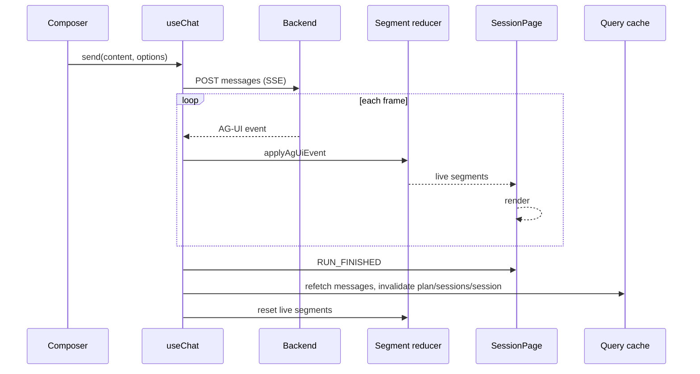
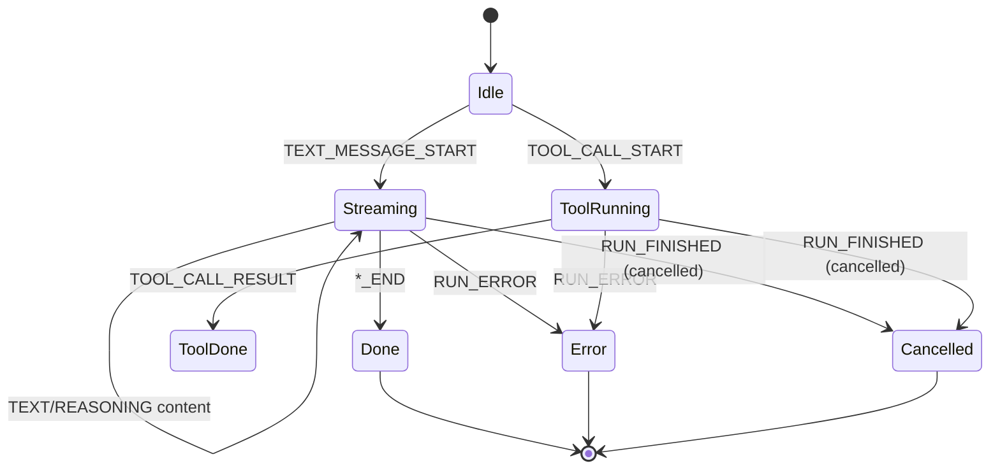

# Chat and Streaming

**Scope:** How the web client sends a turn, consumes the AG-UI event stream, turns events into
ordered live segments, renders persisted and live content, and supports edit/fork, retry, stop,
attachments, file mentions, skills, MCP apps, and Mermaid diagrams.

## Stream request and lifecycle

`src/chat/agent.ts` implements a small SSE client rather than using `@ag-ui/client`:

1. `POST {API_URL}/sessions/{sid}/messages` with `Accept: text/event-stream` and a bearer token.
2. Body: `content`, `mode`, `fork`, `fork_from_turn_id`, `attachment_ids`, `skill`, and
   `retry_turn_id`.
3. Read the response body with a `ReadableStreamDefaultReader`, normalize CRLF to LF, split on
   blank-line frame boundaries, keep `data:` lines, and JSON-parse each frame.

`useChat` owns the run state: `idle → running → cancelling`, returning to idle on success,
cancellation, or error. `send()` clears live segments, errors, and id refs before starting.
`cancel()` sets a ref, switches to `cancelling`, and posts to
`POST /sessions/{sid}/messages/cancel`. `RUN_FINISHED` finalizes as cancelled when a cancel was
requested, otherwise as success.

*Figure 1 — Chat stream lifecycle.*

## Event-to-segment reducer

`src/chat/segments.ts` defines four segment kinds in arrival order: `text`, `reasoning`, `tool`,
and `app`. Each carries an id, status, and kind-specific fields.

| Event | Effect |
|---|---|
| `TEXT_MESSAGE_START` | Append a streaming text segment |
| `TEXT_MESSAGE_CONTENT` / `_CHUNK` | Append the delta to the matching text segment |
| `TEXT_MESSAGE_END` | Mark done; drop the segment if it is empty |
| `REASONING_MESSAGE_START` | Append a streaming reasoning segment with `startedAt` |
| `REASONING_MESSAGE_CONTENT` / `_CHUNK` | Append the delta |
| `REASONING_MESSAGE_END` | Mark done with `endedAt`; drop if empty |
| `TOOL_CALL_START` | Append a running tool segment |
| `TOOL_CALL_ARGS` / `_CHUNK` | Append argument deltas |
| `TOOL_CALL_END` | No state change |
| `TOOL_CALL_RESULT` | Stringify and attach the result; mark success and `endedAt` |
| `ACTIVITY_SNAPSHOT` | Append an app segment and add an MCP app tab |
| `RUN_ERROR` | Record the error and finalize everything as error |
| `RUN_FINISHED` | Finalize as success or cancelled |
| `CUSTOM` name `mcp.warning` | Show a notification |

`useChat` tolerates streams that omit ids: it reuses the last text/reasoning/tool id or generates
a UUID, so chunk-style events still create segments. `finalizeSegments` closes any still-streaming
text/reasoning and converts running tools to success, error, or cancelled.

*Figure 2 — Live segment state machine.*

## Rendering live and persisted turns

`SessionPage` renders persisted messages and live segments in one scroll container:

- Persisted user turns render as user cards and expose an Edit action.
- Persisted assistant turns render Markdown, activity chips, attachments, and a Copy Markdown
  action; failed or cancelled turns offer Retry.
- `role: "summary"` turns render as a collapsible `SummaryNotice`.
- A newly sent turn is shown optimistically as a pending user message while the answer streams.
- The plan panel appears above the messages; plan errors render an `ErrorCard`.
- Token usage comes from the latest assistant message's `context_tokens` and appears in the
  header.
- `useAutoScroll` sticks to the bottom within 64px and shows "jump to latest" when scrolled up.

Persistence is server-authoritative. After a send or retry, `refresh()` refetches
`["messages", sid]` and invalidates the plan, sessions, and session queries, then resets live
segments. Live segments and app tabs are not reconstructed from history.

## Edit, fork, retry, stop

| Action | Behavior |
|---|---|
| Edit | Only user messages. Loads the content into the composer, sets fork mode, and records `fork_from_turn_id = message.parent_id`. Sending creates a branch; cancelling the banner restores the previous input. |
| Retry | Finds the failed/cancelled assistant turn, walks to its parent user turn, reuses its content and attachment ids, and sends `retry_turn_id`. |
| Stop | Calls `useChat.cancel()` and posts the cancel endpoint; the UI finalizes as cancelled. |

## Composer

`Composer.tsx` owns the input, mode selector, attachments, speech, and the two autocomplete
menus.

- **Mode:** sends `ask` or `agent`.
- **Attachments:** files are uploaded immediately via `POST /sessions/{sid}/attachments`; only
  ids are kept locally and sent with the turn. Persisted attachment chips download through an
  authenticated raw fetch.
- **File mentions:** a trailing `@word` triggers `GET /sessions/{sid}/files?q=...`; selecting a
  match replaces `@query` with `@relative/path `. No file content is uploaded.
- **Skills:** a leading `/` opens the skill menu backed by `GET /skills`; selecting sends the
  skill name with the turn.
- **Speech:** uses the Web Speech API when available; transcript text appends to the composer and
  stops on submit.

## MCP apps

MCP servers can emit app UI. `ACTIVITY_SNAPSHOT` events with `activityType === "mcp-apps"` become
an `AppTab` containing `serverId`, `resourceUri`, `toolInput`, and `toolResult`. Tabs are
deduplicated by id.

`AppPanel` renders each tab with `@mcp-ui/client`'s `AppRenderer` in the sandbox. Host callbacks
are proxied by the backend:

- `onReadResource` → `POST /sessions/{sid}/mcp/{server_id}/resources/read`.
- `onCallTool` → `POST /sessions/{sid}/mcp/{server_id}/tools/call`.
- `onOpenLink` opens a new tab with `noopener,noreferrer`.

`ChatSplit` shows chat only when there are no apps. On desktop it is a resizable split (32–68%)
with a keyboard-accessible divider; on mobile it exposes an "Open app" button and a full-width
drawer. App tabs survive sends and `reset()` but are lost on navigation or reload.

## Markdown, code, and Mermaid

`MarkdownBlock` uses `react-markdown` with `remark-gfm` and overrides `pre` to extract fenced
code:

- A still-open fence during streaming is detected; Mermaid shows "Diagram building." until the
  fence is complete.
- Complete Mermaid fences are rendered with `mermaid.render`; parse errors fall back to a code
  block with copy.
- Successful diagrams render inside `react-zoom-pan-pinch` with zoom in/out, reset, copy, and a
  Fullscreen API toggle.
- Other fenced code is highlighted with `highlight.js` and gets a copy button.
- External links open with `target="_blank"` and `rel="noreferrer"`.

## Implementation notes

> **Implementation note:** the AG-UI stream is parsed by a custom SSE reader. `@ag-ui/client` is a
> dependency, but only `@ag-ui/core` event types are used.

> **Implementation note:** `ToolCallBlock` and `ReasoningBlock` exist but are not imported by
> production code; `SessionPage` renders equivalent markup inline.

> **Implementation note:** Mermaid uses module-level defaults and does not re-render on theme
> change.

> **Implementation note:** live segments and app tabs are client-only. A reload shows persisted
> messages but not in-progress traces or open apps.

## Related

- [Frontend](08-frontend.md)
- [Protocols](07-protocols.md)
- [Concurrency and lifecycle](10-concurrency-and-lifecycle.md)
- [Testing and observability](11-testing-and-observability.md)
- [Index](README.md)
