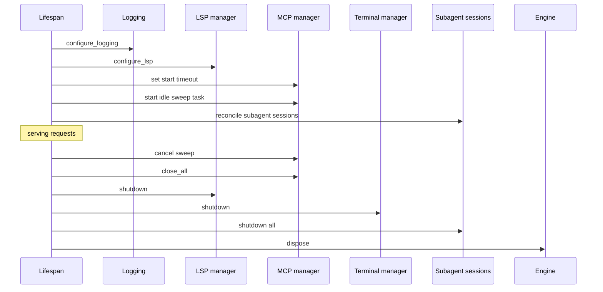
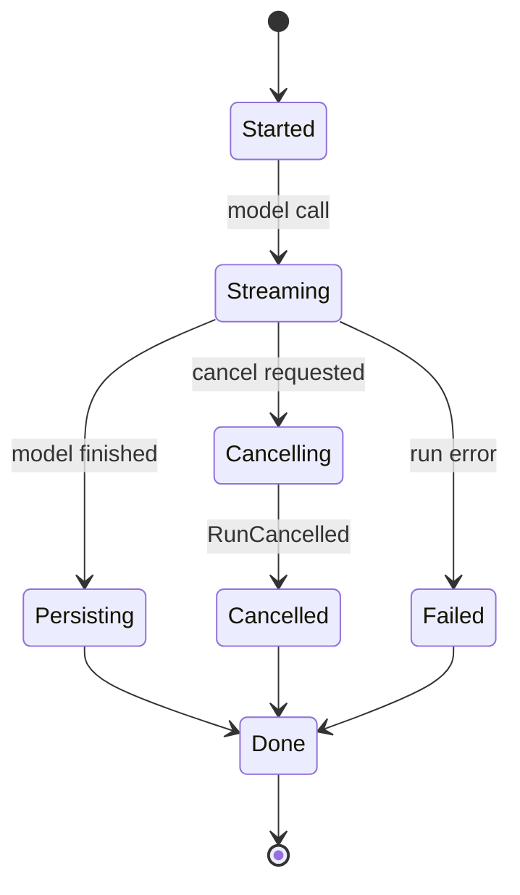
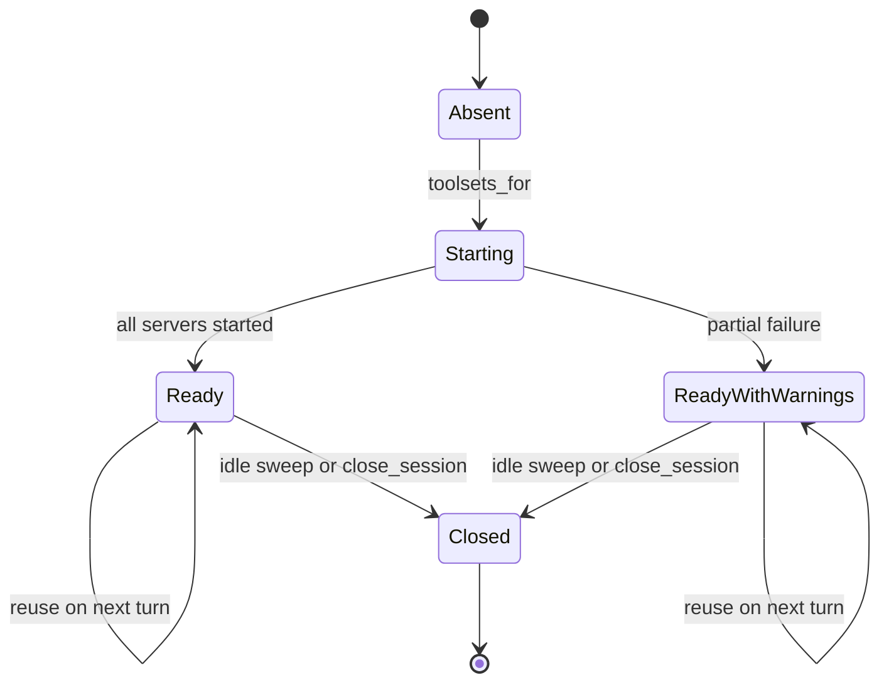

# Concurrency and Lifecycle

**Scope:** How work is scheduled and torn down: application lifespan, the run registry and
cancellation, event-bus consumers, subagent sessions, session-scoped MCP processes, global LSP
and terminal managers, and the cleanup path shared by HTTP, ACP, A2A, and shutdown.

## Application lifespan

Startup prepares logging and LSP, sets MCP timeouts, starts the idle sweep, and reconciles
subagent sessions left behind by a previous process. Shutdown reverses that order and drains
every long-lived resource.

*Figure 1 — Application lifespan.*

Reconciliation marks any `SessionRow` whose `subagent_session_status` is `running` as `failed`
with "interrupted by backend restart". This is the durable signal that a subagent session was
abandoned; its turns and output remain readable.

## Run model and cancellation

Each turn is an `asyncio.Task`. `RunRegistry` maps a session id to at most one `Cancellable` run:

- `register(session_id, run)` replaces any previous entry.
- `cancel(session_id)` cancels the tracked run and reports whether one existed.
- `finish(session_id)` removes the entry.

A run owns a `CancellationToken`. Cancellation raises `RunCancelled`, which the harness normalizes
to `RunOutcome(status="cancelled")`. The persistence task still writes the partial assistant turn
collected so far, so a stopped run leaves a cancelled turn with visible text and activity.

*Figure 2 — Run and cancellation state machine.*

## Event bus consumers

A run publishes `RunEvent(run_id, seq, event)` on a per-run `EventBus`. The bus keeps a replay
history and one queue per subscriber. A subscription replays existing events and then follows
live ones until the bus closes.

Two consumers share the same stream:

1. The HTTP/SSE (or ACP/A2A) request path, which maps events to the protocol wire format.
2. The persistence task, which uses the activity collector to build the assistant turn.

MCP startup warnings are injected as custom events before the run events, using negative
sequence numbers so they sort first.

## Subagent sessions

Subagent sessions are background child sessions started by a session tool using any agent
configuration.

- Caps: at most 5 concurrent subagent sessions per parent (`MAX_SUBAGENT_SESSIONS`) and depth 3
  (`MAX_SUBAGENT_SESSION_DEPTH`).
- Each subagent session is a real `SessionRow` with `parent_session_id`,
  `subagent_session_depth`, and a status.
- `SubagentSessionManager` keeps active jobs in a process-global map. Each job subscribes to the
  subagent session's `EventBus`, buffers a rolling live-output tail, and exposes wait/any/all and
  recursive cancellation.
- Status and final output are persisted on completion, failure, or cancellation. A stale
  `running` row with no live job is marked failed.
- Subagent sessions are not registered in the HTTP `RunRegistry`; they are canceled through
  `cancel_subagent_sessions`, `shutdown_subagent_sessions`, or the parent's cleanup.
- On startup, orphaned `running` subagent sessions are marked failed.

## MCP session lifecycle

Stdio MCP processes are expensive and are cached per session.

- `McpSessionManager` is a process-global singleton.
- Each session entry has a lock so concurrent turns do not start duplicate processes.
- Servers start concurrently with a configured timeout; a failed server yields an `McpWarning`
  and the rest of the toolsets remain usable.
- `sweep_idle(ttl)` runs on an interval from the lifespan and closes sessions that have been idle
  longer than `mcp_idle_ttl_seconds`.
- `close_session` is called on session deletion and ACP close; `close_all` on shutdown.

*Figure 3 — MCP stdio session lifecycle.*

## Global managers

**LSP.** `LspManager` is a process-global singleton. It keeps one server per
`(project_root, stack)`, a reader task per server, and failure backoff. It records which servers a
session used so `GET /sessions/{sid}/lsp` can report status. There is no idle eviction; shutdown
stops all servers.

**Terminal.** `JobManager` is a process-global singleton with per-session job maps. Each job has
an output-drain task. Limits: 20 jobs per session, configurable timeout, truncation for long
output, and process-tree kill. Shutdown kills every session's jobs.

**Project instructions and avatars.** Project-instruction state is cached per session in a
module-global map and cleared during session cleanup. Default avatars are generated behind an
LRU cache.

## Cleanup and cross-protocol coupling

All session teardown funnels through `runtime.delete_session_data`:

1. Close the session's MCP toolsets.
2. Clear project-instruction state.
3. Kill terminal jobs for the session.
4. Recursively cancel active subagent sessions.
5. Recursively delete child sessions.
6. Delete turns, attachments, plan items, and the session row.

Deleting a project runs the same path for each of its sessions. ACP `close_session` and
application shutdown perform overlapping cleanup; both paths are written to be idempotent.

> **Implementation note:** because cleanup is central but called from several places, changes to
> session-owned resources must be added to `delete_session_data`, not only to the router that
> deletes sessions.

> **Implementation note:** the idle sweep is a single task. If it blocks, MCP sessions accumulate
> until shutdown; keep the sweep loop free of long operations.

## Related

- [Harness and runtime](04-harness-runtime.md)
- [Protocols](07-protocols.md)
- [Backend](03-backend.md)
- [Data model](05-data-model.md)
- [Index](README.md)
