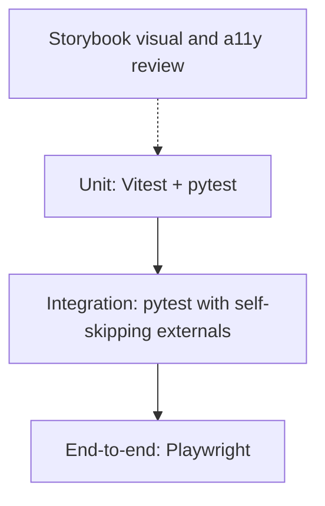
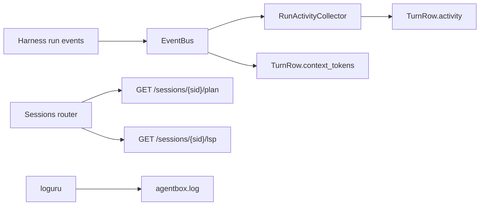

# Testing and Observability

**Scope:** How the project is verified (unit, integration, e2e, Storybook), the commands that
gate a change, the logging setup, and the runtime signals that make a session observable.

## Test layers

*Figure 1 — Test layers.*

## Backend testing

Backend tests are pytest suites inside each package.

- Run one package per invocation:
  - `uv run pytest packages/agentbox-models -q`
  - `uv run pytest packages/agentbox-harness -q`
  - `uv run pytest packages/agentbox-providers -q`
  - `uv run pytest packages/agentbox-api -q`
- Every package sets `timeout = 60` with `timeout_method = "thread"`. Do not remove it. If a test
  hangs, run the focused node with a smaller `--timeout` to get a stack dump, then fix the cause
  rather than raising the limit.
- Do not pass multiple package directories to one pytest run. Duplicate `test_scaffold.py`
  basenames cause an import-mismatch collection error.
- External integration tests (Ollama, real LSP servers, `uvx` MCP servers) self-skip when the
  tool is absent. They run in CI-like environments where the tool exists.
- `pytest-asyncio` is in `auto` mode with function-scoped loops.

## Frontend testing

- **Vitest** runs colocated `*.test.ts(x)` under `src` with jsdom. `src/test/setup.ts` installs
  jest-dom matchers and stubs `matchMedia` and `ResizeObserver`; `src/test/render.tsx` provides
  `renderWithTheme`, which forces the dark scheme.
- **Playwright** runs in `apps/web/e2e` with one worker and an HTML reporter. It starts four
  servers:
  - a stub model server on port 9999;
  - an MCP app test server on port 9000;
  - the backend on port 8000 with `e2e.db` and `e2e-skills`;
  - Vite on port 5173.
  `e2e/prepare.ts` deletes `e2e.db` and `e2e-skills` first. A global storage state pre-dismisses
  the onboarding wizard. Ports 5173, 8000, 9000, and 9999 must be free.
- **Storybook** collects component stories, provides theme and viewport globals, and fails on
  accessibility errors. It is the visual review surface, not a substitute for integrated e2e.

## Checks and generated artifacts

| Command | Purpose |
|---|---|
| `uv run ruff check --fix packages` | Format/lint Python |
| `uv run ty check packages` | Type-check Python |
| `uv run pytest packages/<pkg> -q` | One package's tests |
| `cd apps/web && bun run test` | Vitest (e2e excluded) |
| `cd apps/web && bun run build` | `tsc --noEmit` + Vite build |
| `cd apps/web && bun run e2e` | Playwright with stub servers |
| `uv run python apps/web/scripts/gen-openapi.py` | Export `openapi.json` |
| `cd apps/web && bun run codegen` | Regenerate `schema.d.ts` |

`just check` runs lint and all tests; `just verify` adds formatting and the web build. Generated
API files are never hand-edited.

## Logging

`configure_logging` installs two loguru sinks:

1. A colored stderr sink at `log_level`.
2. A rotating file sink at `{log_dir}/agentbox.log` with `log_rotation`, `log_retention`,
   `log_compression`, `enqueue=True`, and `diagnose=False`.

When `log_intercept` is on, stdlib loggers (root, uvicorn, starlette, sqlalchemy, asyncio) are
routed through loguru. The backend never writes logs to stdout because ACP uses stdout for
JSON-RPC framing.

## Runtime observability

*Figure 2 — Observability data flow.*

- **Activity:** `RunActivityCollector` derives reasoning text and duration, tool names, arguments,
  results, and timings, and the final assistant text. Fields are capped at 4,000 characters. The
  summary is persisted to `TurnRow.activity` and re-rendered as activity chips.
- **Token usage:** `context_tokens` is stored on assistant turns and surfaced in the session
  header.
- **Plans:** `GET /sessions/{sid}/plan` returns the TODO-style plan and is polled while a run is
  active.
- **LSP status:** `GET /sessions/{sid}/lsp` reports servers used by the session, their state, and
  the stacks detected.
- **MCP warnings:** startup failures are emitted as `mcp.warning` custom events and shown as
  notifications.
- **Run outcomes:** success, cancelled, and error statuses are persisted on the assistant turn so
  the UI can offer Retry.

## Known gaps

- ACP falls back to a development JWT secret when `JWT_SECRET` is unset.
- A2A task state is in memory and does not survive a restart.
- The frontend `mitt` bus is declared but unused.
- `User.is_active` is not enforced by authentication.
- Provider API keys are stored in plaintext.

## Related

- [Technology stack](02-tech-stack.md)
- [Backend](03-backend.md)
- [Harness and runtime](04-harness-runtime.md)
- [Frontend](08-frontend.md)
- [Index](README.md)
