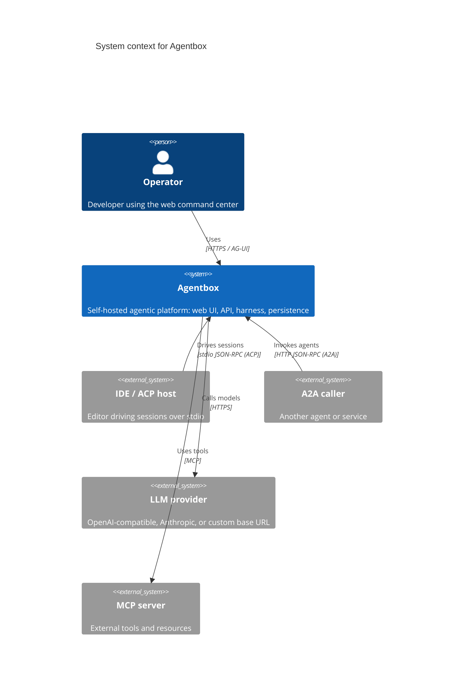
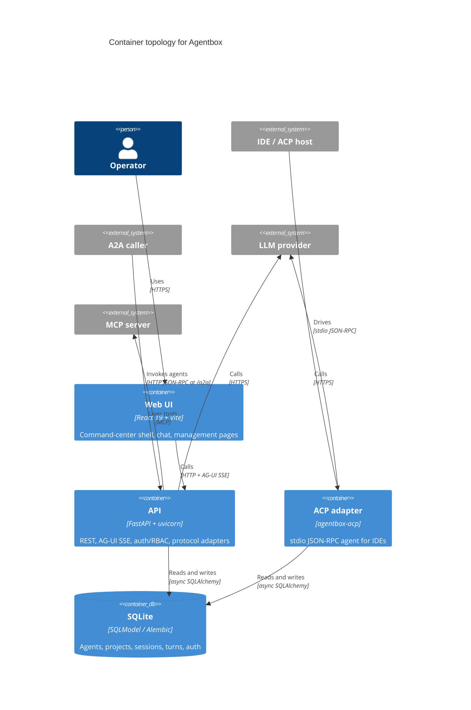

# Agentbox — Technical Architecture

**Scope:** Maintainer reference for the implemented system. The product overview lives in the
[repository README](../../README.md); requirement status lives in the
[roadmap](../ROADMAP.md). These pages explain how the pieces fit together and where to change
them; they do not replace the per-feature specifications.

## System at a glance

Agentbox is a self-hosted agentic platform that turns a local project folder into a workspace for
tool-using LLM agents. A React "command center" web app talks to a FastAPI backend over HTTP and
server-sent events. The backend assembles agents from a pydantic-ai harness: a system prompt, a
model resolved from a provider, and a set of tools (native filesystem/terminal/search tools plus
external MCP servers). Sessions bind an agent to a project folder and persist their turn history
in SQLite. The same harness is driven by four protocol surfaces: AG-UI for the web UI, ACP over
stdio for IDEs, A2A over HTTP for other agents, and MCP for external tools and resources.
Authentication is scope-based RBAC with JWT login and scoped API keys. Everything runs locally:
one SQLite database, one backend process, one web app, and no hosted control plane.

## System context

*Figure 1 — System context.*

## Container topology

*Figure 2 — Container topology.*

## Reading paths

- **New maintainer:** [01](01-system-overview.md) → [02](02-tech-stack.md) →
  [03](03-backend.md) → [04](04-harness-runtime.md) → [05](05-data-model.md).
- **Protocol work:** [07](07-protocols.md) → [04](04-harness-runtime.md) →
  [10](10-concurrency-and-lifecycle.md).
- **Frontend work:** [08](08-frontend.md) → [09](09-chat-and-streaming.md) →
  [02](02-tech-stack.md).
- **Change-impact lookup:** [12](12-glossary-and-decisions.md) → the owning document.

## Documents

| Document | Concern | Key diagrams |
|---|---|---|
| [01 — System overview](01-system-overview.md) | Intent, constraints, runtime topology, package dependency direction, cross-cutting decisions | Package graph, runtime topology |
| [02 — Technology stack](02-tech-stack.md) | Languages, libraries, tooling, ports, generated artifacts | Build pipeline, dev request flow |
| [03 — Backend](03-backend.md) | FastAPI composition, routers, configuration, logging, turn request flow | Middleware chain, router map, HTTP turn |
| [04 — Harness and runtime](04-harness-runtime.md) | `AgentSpec`, sessions, runs, event bus, compaction, tools, LSP | Agent assembly, run/event flow, tool selection |
| [05 — Data model](05-data-model.md) | Tables, relationships, turn chain, deletion, migrations | ERD, turn chain |
| [06 — Auth and security](06-auth-and-security.md) | RBAC, JWT and API keys, dependency pattern, sandboxing | Auth decision flow, RBAC graph |
| [07 — Protocols](07-protocols.md) | AG-UI, ACP, A2A, MCP adapters and their lifecycles | Per-protocol sequences, harness mapping |
| [08 — Frontend](08-frontend.md) | Build, providers, routing, API layer, state, design system, pages | Provider tree, route tree, data flow |
| [09 — Chat and streaming](09-chat-and-streaming.md) | Stream lifecycle, segment reducer, composer, MCP apps, Markdown/Mermaid | Stream sequence, segment state machine |
| [10 — Concurrency and lifecycle](10-concurrency-and-lifecycle.md) | Lifespan, runs, sub-sessions, MCP sessions, global managers, cleanup | Lifespan timeline, run/cancel, MCP lifecycle |
| [11 — Testing and observability](11-testing-and-observability.md) | Test strategy, e2e harness, logging, activity and token capture | Test pyramid, observability flow |
| [12 — Glossary and decisions](12-glossary-and-decisions.md) | Terms, decision log, "where to change X" map | — |

## Sources of truth

| Source | Authoritative for |
|---|---|
| [`README.md`](../../README.md) | Product intent, features, quick start |
| [`docs/initial_spec.md`](../initial_spec.md) | Original product specification |
| [`docs/ROADMAP.md`](../ROADMAP.md) | Requirement coverage and sub-project history |
| [`docs/superpowers/specs/`](../superpowers/specs/) | Per-feature design decisions |
| [`docs/superpowers/plans/`](../superpowers/plans/) | Per-feature implementation plans |
| [`apps/web/openapi.json`](../../apps/web/openapi.json) | Generated API document |
| [`apps/web/src/api/schema.d.ts`](../../apps/web/src/api/schema.d.ts) | Generated TypeScript API types |

## Related

- [Design spec](../superpowers/specs/2026-11-22-technical-architecture-docs-design.md)
- [Implementation plan](../superpowers/plans/2026-11-22-technical-architecture-docs.md)
- [Next: System overview](01-system-overview.md)
