# UX-2 chat surface screenshot pack

Deterministic Storybook captures for the UX-2 chat surface. Dark theme unless noted.

## Markdown, code, and diagrams

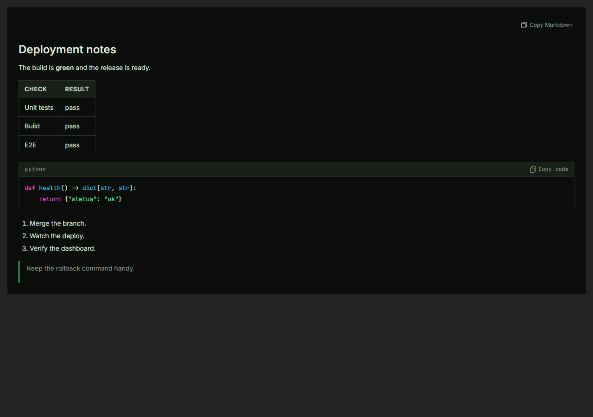

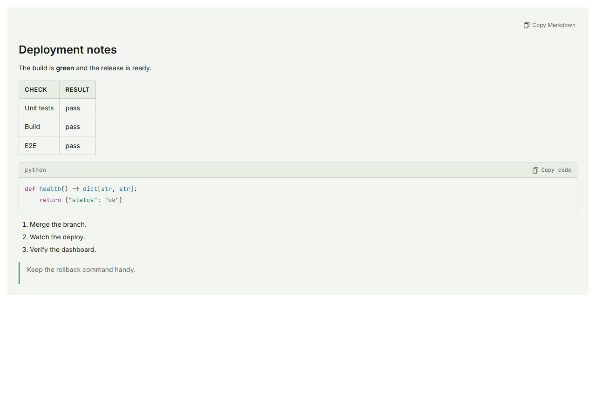

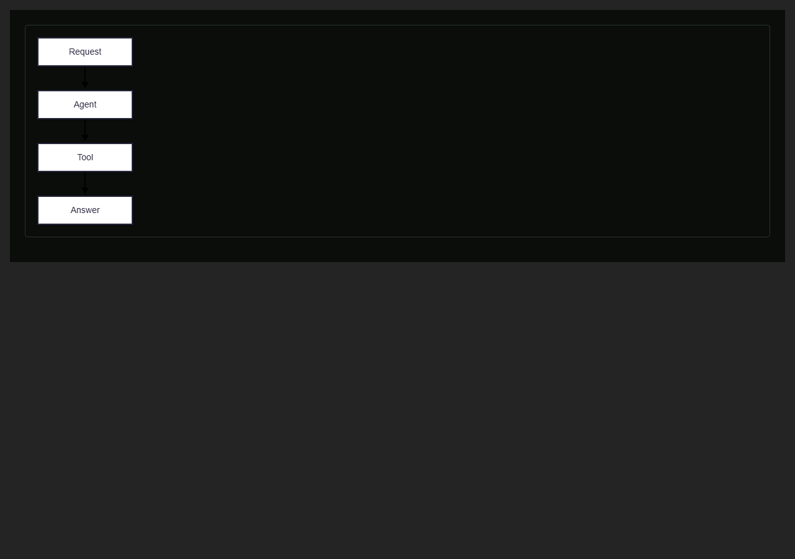

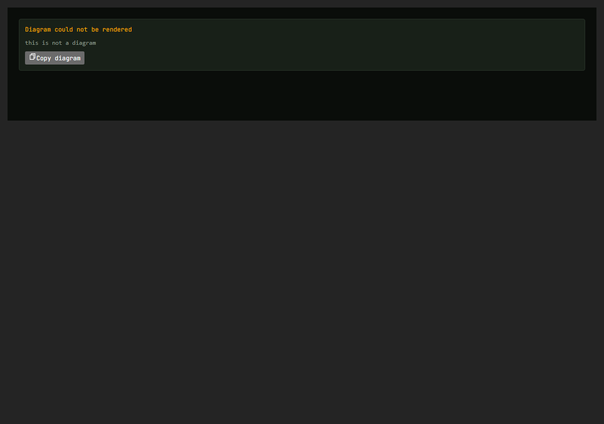

## Live run and persisted activity

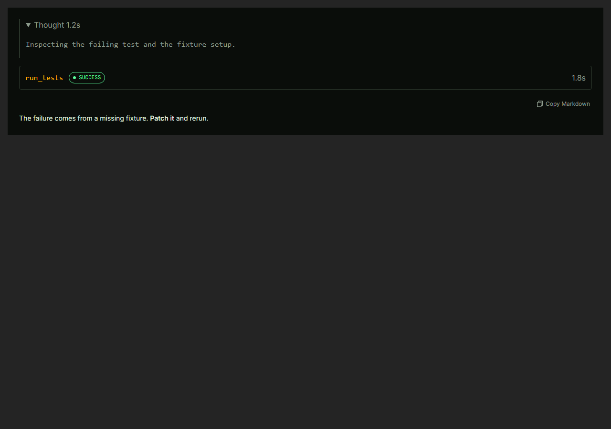

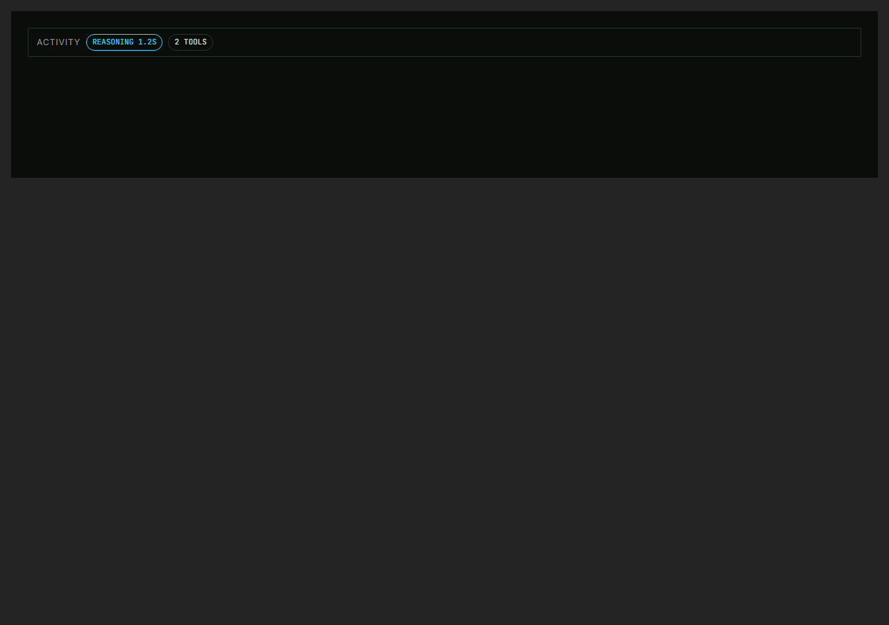

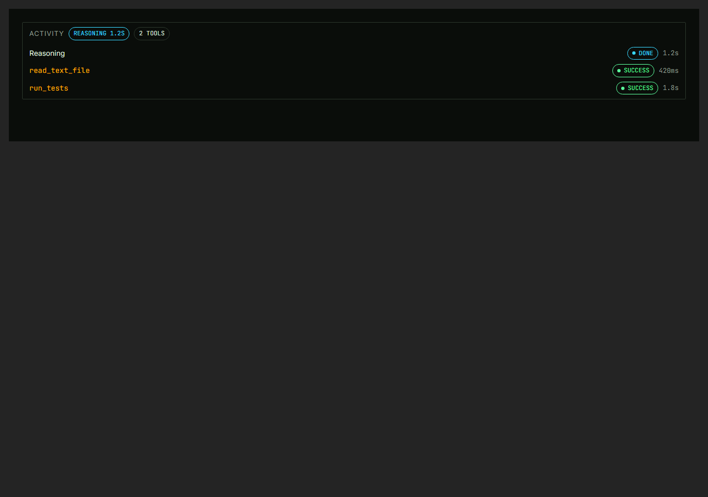

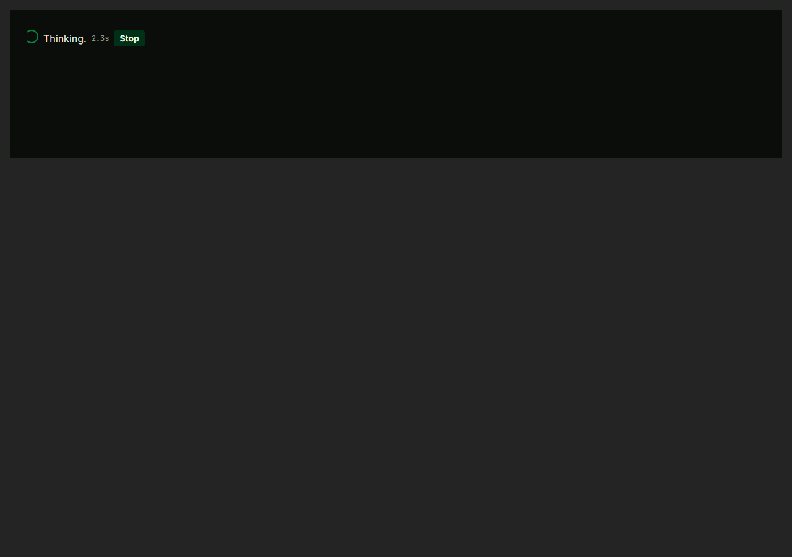

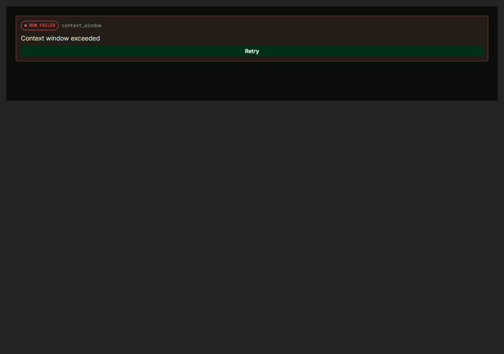

## Composer and edit state

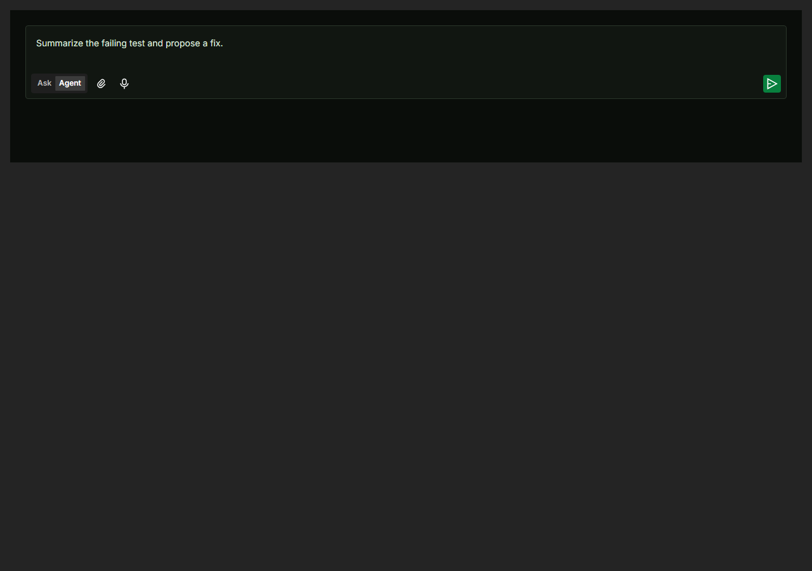

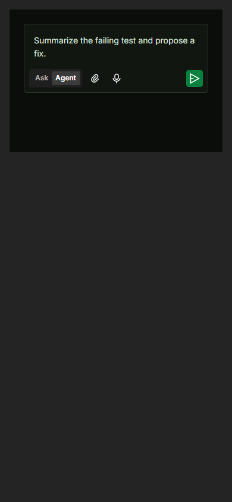

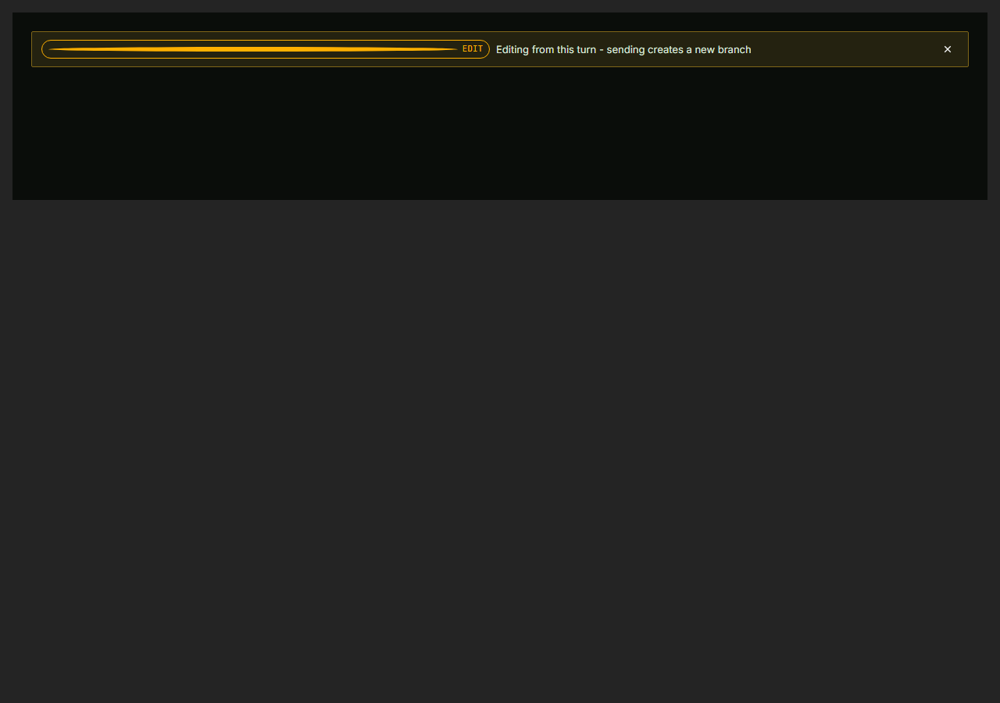

## Attachments and MCP split view

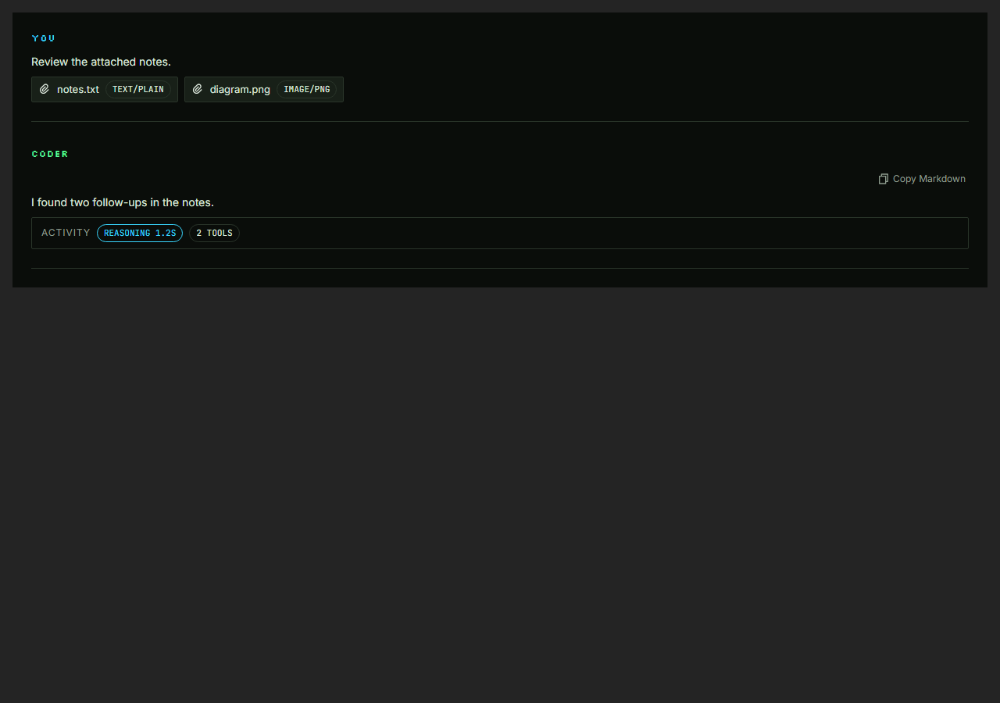

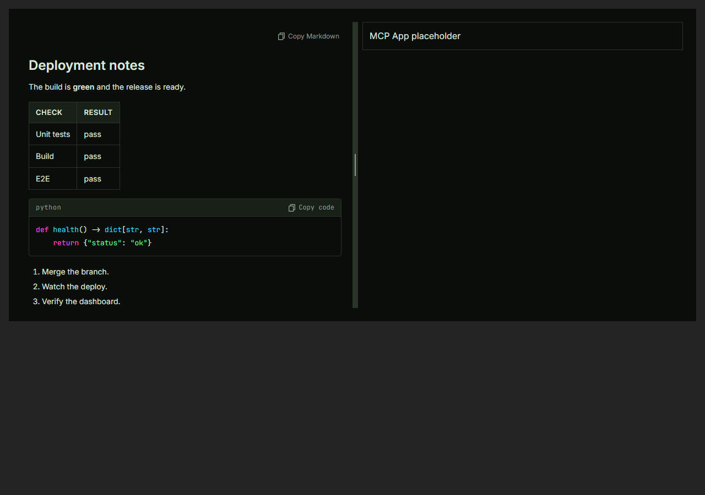

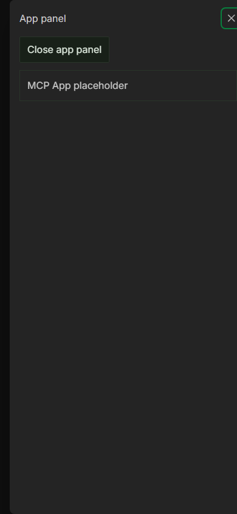
