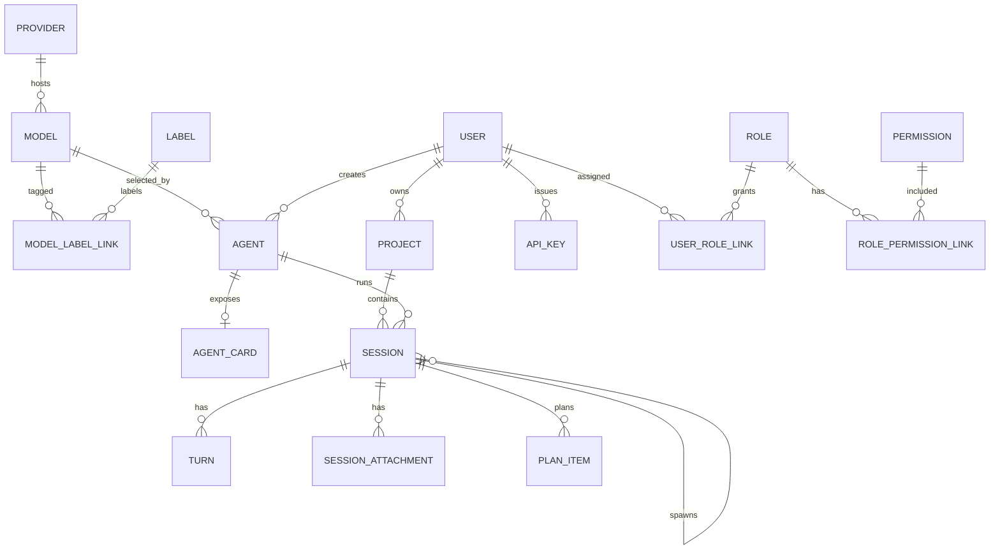
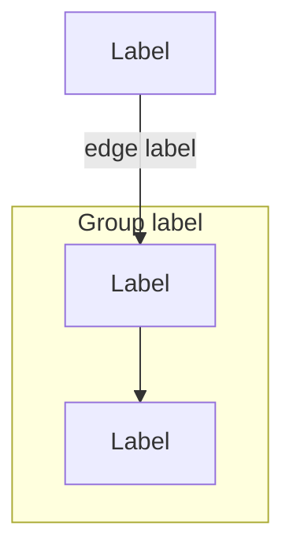
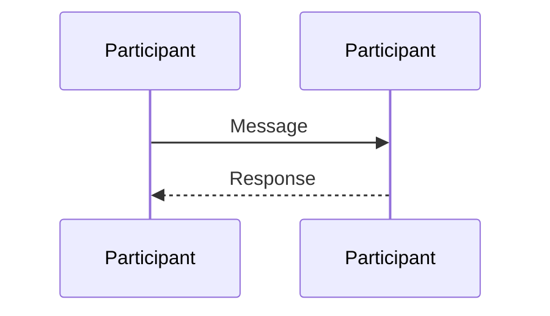
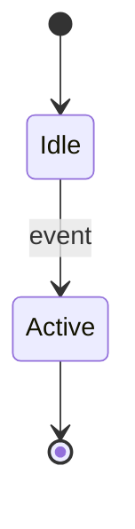
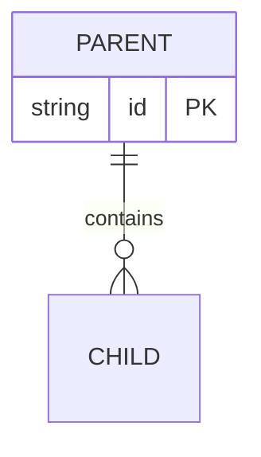
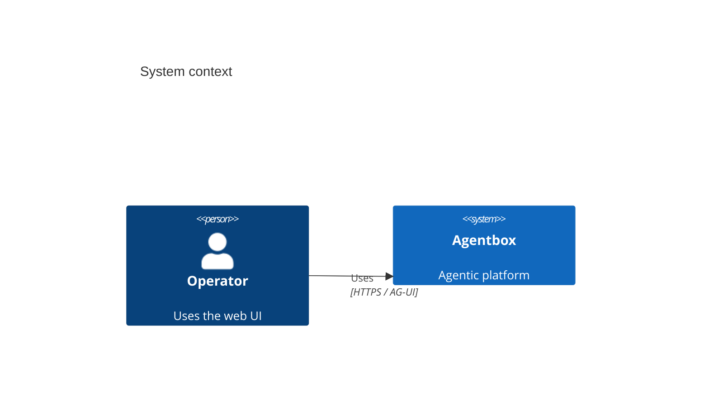
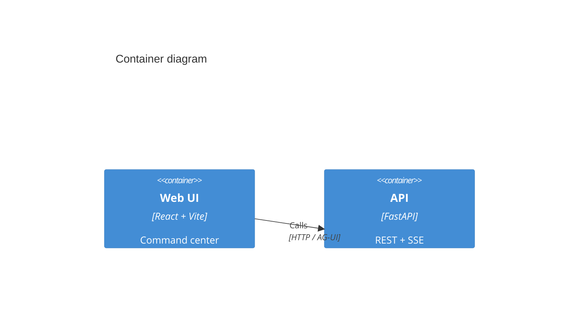

# Technical Architecture Documentation Implementation Plan

> **For agentic workers:** REQUIRED SUB-SKILL: Use superpowers:subagent-driven-development (recommended) or superpowers:executing-plans to implement this plan task-by-task. Steps use checkbox (`- [ ]`) syntax for tracking.

**Goal:** Create a 13-file maintainer-oriented technical architecture documentation set under `docs/architecture/`, with Mermaid diagrams, that accurately describes the implemented Agentbox system.

**Architecture:** One index plus twelve docs split by runtime concern. Each doc owns one concern, cites source files as `path:line`, carries Mermaid diagrams, and cross-links instead of duplicating existing specs. Content is derived from the code, not from aspirational specs.

**Tech Stack:** Markdown, Mermaid (`flowchart`, `sequenceDiagram`, `stateDiagram-v2`, `erDiagram`, `C4Context`, `C4Container`), PowerShell for verification. No new dependencies.

## Global Constraints

- No new runtime or build dependencies; documentation only.
- Mermaid syntax must render in both GitHub and VS Code Markdown preview. Use conservative syntax; avoid `%%{init}%%` directives and experimental diagram types.
- All relative links only. No absolute local paths (`C:\...`, `file://`). No secrets, tokens, or real API keys.
- Cite code as `` `packages/.../file.py:line` ``. Cite specs with relative links into `docs/superpowers/`.
- Document current implemented behavior only. Mark surprising/legacy behavior with a `> **Implementation note:**` blockquote.
- Do not hand-edit or reproduce `openapi.json` or `apps/web/src/api/schema.d.ts`.
- Do not duplicate the product spec, roadmap, or per-feature specs; summarize and link.
- Every doc starts with one `# H1`, a short "Scope" paragraph, numbered `##` sections, and ends with a "Related" link list.
- Diagram captions: one italic line immediately above each Mermaid block, e.g. `*Figure 1 — Package dependency direction.*`
- Verification commands run from the repo root. On Windows use `pwsh`.

---

### Task 1: Create the architecture directory and index

**Files:**
- Create: `docs/architecture/README.md`
- Create: `docs/architecture/` (directory)

**Interfaces:**
- Consumes: nothing.
- Produces: `docs/architecture/README.md` with stable relative links to `01-` through `12-` files. Later tasks assume these filenames are exact:
  - `01-system-overview.md`, `02-tech-stack.md`, `03-backend.md`, `04-harness-runtime.md`,
    `05-data-model.md`, `06-auth-and-security.md`, `07-protocols.md`, `08-frontend.md`,
    `09-chat-and-streaming.md`, `10-concurrency-and-lifecycle.md`,
    `11-testing-and-observability.md`, `12-glossary-and-decisions.md`.

- [ ] **Step 1: Create the directory**

Run:
```powershell
New-Item -ItemType Directory -Path docs/architecture -Force | Out-Null
Test-Path docs/architecture
```
Expected: `True`

- [ ] **Step 2: Write `docs/architecture/README.md`**

Include exactly these sections in order:

1. `# Agentbox — Technical Architecture` and a Scope paragraph: "Maintainer reference for the implemented system. Product overview lives in `../../README.md`; requirement status in `../ROADMAP.md`."
2. `## System at a glance` — a 6–8 sentence paragraph: self-hosted agentic platform; React command-center UI; FastAPI backend; pydantic-ai harness; SQLite persistence; protocol adapters AG-UI/ACP/A2A/MCP over one harness.
3. `## System context` — `C4Context` diagram with these elements: `Person(user, "Operator")`, `System_Ext(ide, "IDE / ACP host")`, `System_Ext(a2a, "A2A caller")`, `System_Ext(llm, "LLM provider")`, `System_Ext(mcp, "MCP server")`, `System(agentbox, "Agentbox")`, and relationships: operator uses over HTTPS/AG-UI; IDE drives over stdio JSON-RPC; A2A caller over HTTP JSON-RPC; Agentbox calls LLM provider, MCP server; Agentbox stores sessions in SQLite (container diagram covers that).
4. `## Container topology` — `C4Container` diagram with: `Container(web, "Web UI", "React 19 + Vite")`, `Container(api, "API", "FastAPI + uvicorn")`, `ContainerDb(db, "SQLite", "SQLModel/Alembic")`, `Container(acp, "ACP adapter", "stdio JSON-RPC")`, plus external LLM and MCP. Edges: web → api (HTTP + SSE AG-UI), api → db, ide → acp → api code (harness), api → LLM, api → MCP, a2a → api `/a2a`.
5. `## Reading paths` — four bullet paths exactly:
   - New maintainer: 01 → 02 → 03 → 04 → 05.
   - Protocol work: 07 → 04 → 10.
   - Frontend work: 08 → 09 → 02.
   - Change-impact lookup: 12 → target doc.
6. `## Documents` — a table with columns `Document | Concern | Key diagrams`, one row per `01`–`12` file, linked.
7. `## Sources of truth` — table: `README.md` (product/quick start), `docs/initial_spec.md` (original spec), `docs/ROADMAP.md` (status), `docs/superpowers/specs/` (feature design), `docs/superpowers/plans/` (feature plans), `apps/web/openapi.json` + `apps/web/src/api/schema.d.ts` (generated API types).
8. `## Related` — link to the design spec `../superpowers/specs/2026-11-22-technical-architecture-docs-design.md`.

- [ ] **Step 3: Verify links and structure**

Run:
```powershell
Test-Path docs/architecture/README.md
Select-String -Path docs/architecture/README.md -Pattern '^# |^## '
```
Expected: `True`, then the eight headings listed above.

- [ ] **Step 4: Commit**

```powershell
git add docs/architecture/README.md
git commit -m "docs(architecture): add architecture index and context diagrams"
```

---

### Task 2: System overview and cross-cutting decisions

**Files:**
- Create: `docs/architecture/01-system-overview.md`

**Interfaces:**
- Consumes: filenames from Task 1.
- Produces: the authoritative package dependency graph and decision summary linked by later docs.

**Key facts (verified from code):**
- Dependency direction: `agentbox-harness` has no local deps; `agentbox-models` depends on harness; `agentbox-providers` depends on models; `agentbox-api` depends on models, providers, harness. Source: each `packages/*/pyproject.toml`.
- Intentional upward coupling: `agentbox_models.repos.agents` imports `AgentSpec`, `McpToolBinding`, `Mode`, `ModelBinding`, `NativeToolBinding` from `agentbox_harness.spec`; `agentbox_models.repos.message_log` imports `Turn` from `agentbox_harness.session`.
- No module-level FastAPI `app`; build with `create_app(Settings(...))` (`packages/agentbox-api/src/agentbox_api/app.py`).
- Constraints from `README.md`: protocol compliance over homegrown plumbing; local-first/self-hosted; ambition in the UI; async where possible.
- `apps/web` is a separate Bun project, not a uv workspace member.
- Turn-chain history: `TurnRow.parent_id` links turns; sessions derive the leaf (implementation note; `head_turn_id` is legacy).

- [ ] **Step 1: Write `01-system-overview.md`**

Sections:
1. Scope.
2. `## Intent and constraints` — table `Constraint | Consequence` with the four README constraints and one consequence each.
3. `## Runtime topology` — describe browser → Vite proxy (`/api` stripped) → uvicorn; ACP stdio process; A2A mount; SQLite file; external LLM/MCP.
4. `## Package dependency direction` — prose plus the package graph diagram. Include the upward-coupling implementation note.
5. `## Composition root` — no module-level app; `create_app`, `dev_server`, `acp_server` entry points.
6. `## Cross-cutting decisions` — table with columns `Decision | Rationale | Trade-off | Detail in`; rows: protocol adapters over a shared harness; turn-chain persistence; session-scoped stdio MCP; scope-based auth; JSON-text agent definitions; async throughout; local-first single SQLite. "Detail in" links to `03`–`07`.
7. `## Related`.

- [ ] **Step 2: Add the package graph diagram**

*Figure 1 — Python package dependency direction.* Use `flowchart TB` with nodes `web["apps/web (Bun)"]`, `api`, `providers`, `models`, `harness`, and edges `web -->|HTTP + AG-UI| api`, `api --> providers`, `api --> models`, `api --> harness`, `providers --> models`, `models --> harness`. Use `subgraph` labels `Python uv workspace` and `Separate Bun project`.

- [ ] **Step 3: Add the runtime topology diagram**

*Figure 2 — Local runtime topology.* Use `flowchart LR` with: browser, vite["Vite dev 5173"], api["FastAPI 8000"], db[("SQLite")], llm["LLM provider"], mcp["MCP servers"], ide["IDE / ACP"], a2a["A2A caller"]. Edges: browser --> vite --> api; api --> db; api --> llm; api --> mcp; ide -->|stdio| api; a2a -->|/a2a| api.

- [ ] **Step 4: Verify cited paths exist**

Run:
```powershell
@(
 'packages/agentbox-api/src/agentbox_api/app.py',
 'packages/agentbox-models/src/agentbox_models/repos/agents.py',
 'packages/agentbox-models/src/agentbox_models/repos/message_log.py',
 'packages/agentbox-harness/src/agentbox_harness/spec.py',
 'packages/agentbox-harness/src/agentbox_harness/session.py'
) | ForEach-Object { "$_ : $(Test-Path $_)" }
```
Expected: five lines ending in `: True`.

- [ ] **Step 5: Commit**

```powershell
git add docs/architecture/01-system-overview.md
git commit -m "docs(architecture): add system overview"
```

---

### Task 3: Technology stack

**Files:**
- Create: `docs/architecture/02-tech-stack.md`

**Interfaces:**
- Consumes: nothing beyond filenames.
- Produces: stack inventories referenced by `03` and `08`.

**Key facts (verified):**
- Python: 3.11, uv workspace members `packages/*`.
- Backend deps: `fastapi>=0.115`, `uvicorn`, `pyjwt`, `bcrypt`, `pydantic-settings`, `pydantic-ai[ag-ui]>=2.0`, `agent-client-protocol>=1.0`, `a2a-sdk[fastapi]>=1.3`, `skills-ref`, `jinja2`, `loguru`, `robohash`, `pillow`.
- Backend dev: pytest, pytest-asyncio, pytest-timeout; Ruff (line length 100, py311), `ty`, bandit.
- Frontend deps: React 19, Vite 8, Mantine 9, TanStack Query 5, Zustand 5, React Router 7, `openapi-fetch` 0.17, `@ag-ui/client`/`@ag-ui/core` 1.0, `@mcp-ui/client` 7, `react-markdown` 10, `remark-gfm`, `highlight.js` 11, `mermaid` 12, `react-zoom-pan-pinch` 4, `mitt` 3, `@remixicon/react` 4.
- Frontend dev: TypeScript 5 strict, Vitest 5, Playwright, Storybook 10, `openapi-typescript` 7.
- Ports: backend 8000; Vite 5173; e2e stub model 9999; e2e MCP app 9000; Storybook 6006.
- Generated artifacts: `apps/web/openapi.json` via `uv run python apps/web/scripts/gen-openapi.py`, then `bun run codegen`.
- Tests: one pytest invocation per package; 60s `pytest-timeout`; do not pass multiple package dirs to one run.

- [ ] **Step 1: Write `02-tech-stack.md`**

Sections:
1. Scope.
2. `## Backend stack` — table `Layer | Technology | Version floor | Role`.
3. `## Frontend stack` — same columns.
4. `## Tooling and pipelines` — uv, Bun, `just`, Ruff/ty, pytest split, Vitest/Playwright/Storybook.
5. `## Local development topology` — proxy behavior, ports table, DB default `./agentbox.db`.
6. `## Generated artifacts` — the two-step regeneration commands and the "never hand-edit" rule.
7. `## Why these dependencies` — one-line rationale table for notable entries (pydantic-ai, AG-UI, ACP SDK, a2a-sdk, MCP, Mantine, openapi-fetch, Mermaid, mitt).
8. `## Related`.

- [ ] **Step 2: Add the build/generation pipeline diagram**

*Figure 1 — Build and generation pipeline.* `flowchart LR`: `api["FastAPI app"] --> openapi["openapi.json"] --> codegen["schema.d.ts"] --> web["typed web client"]`; separate `src["React + TS"] --> tsc["tsc --noEmit"] --> vite["vite build"]`; and `pytest`, `vitest`, `playwright`, `storybook` as verification branches.

- [ ] **Step 3: Add the local dev request flow diagram**

*Figure 2 — Local dev request flow.* `flowchart LR`: browser -->|":5173/api"| vite -->|"proxy, strip /api"| api --> db; include `SANDBOX_URL` direct call to `http://localhost:8000/sandbox`.

- [ ] **Step 4: Verify version claims against manifests**

Run:
```powershell
Select-String -Path apps/web/package.json -Pattern '"(react|vite|@mantine/core|@tanstack/react-query|zustand|openapi-fetch|mermaid|vitest)"'
Select-String -Path packages/agentbox-api/pyproject.toml -Pattern 'pydantic-ai|fastapi|agent-client-protocol|a2a-sdk|loguru'
```
Expected: matches for each named dependency. If a version differs, use the manifest value in the doc.

- [ ] **Step 5: Commit**

```powershell
git add docs/architecture/02-tech-stack.md
git commit -m "docs(architecture): add technology stack reference"
```

---

### Task 4: Backend application

**Files:**
- Create: `docs/architecture/03-backend.md`
- Reference: `packages/agentbox-api/src/agentbox_api/{app,config,deps,security,auth_backend,runs,runtime,streaming,activity,skills,plan_tools,project_instructions,templating,mcp_relay,subsessions,sandbox,avatars,logging,dev_server,dev_seed,validation}.py`, `routers/*.py`

**Interfaces:**
- Consumes: stack facts from Task 3.
- Produces: router/API map, Settings inventory, and HTTP turn flow used by `05`–`11`.

**Key facts (verified):**
- `create_app(settings, engine=None, session_factory=None)`; stores `engine`, `session_factory`, `settings`, `run_registry` on `app.state`.
- Lifespan startup: `configure_logging`, `configure_lsp`, MCP start timeout, MCP sweep task, `reconcile_running_sub_sessions`. Shutdown: cancel sweep, close MCP, LSP shutdown, terminal jobs shutdown, sub-sessions shutdown, engine dispose.
- Middleware order added: `AuthenticationMiddleware(JWTAuthenticationBackend)` then `CORSMiddleware`.
- Routers and prefixes: `/auth`, `/agents`, `/providers`, `/models`, `/permissions`, `/projects`, `/prompts`, `/sessions`, `/users`, `/roles`, `/api-keys`, `/labels`, `/skills`. Hidden `/sandbox` GET. Mount `/a2a`.
- Chat endpoint: `POST /sessions/{sid}/messages` → SSE AG-UI; cancel `POST /sessions/{sid}/messages/cancel`.
- `RunRegistry` keyed by session id (one active run per session).
- Settings groups: database, JWT, CORS, A2A, skills, media, logging, LSP, web search/fetch, compaction, MCP.
- Logging: stderr + rotating file `{log_dir}/agentbox.log`, optional stdlib interception, never stdout (ACP requirement).
- Error model: FastAPI `HTTPException`; harness `normalize_error` → `RunOutcome`; client maps `detail` to `ApiError`.
- Implementation notes: assistant turn persistence runs in a separate `finish()` task; client disconnect can cancel it. `prepare_mcp` warnings are emitted before bus events with negative `seq`.

- [ ] **Step 1: Write `03-backend.md`**

Sections:
1. Scope.
2. `## Module map` — table `Module | Responsibility`.
3. `## Application factory and lifespan` — numbered startup/shutdown lists.
4. `## Middleware chain` — diagram plus explanation.
5. `## API surface` — router table `Prefix | Tag | Responsibility | Notable endpoints` and the special mounts.
6. `## Turn request flow` — numbered step list from router to persistence.
7. `## Configuration` — grouped Settings table `Group | Fields | Notes`.
8. `## Logging` — sinks and the no-stdout rule.
9. `## Error model and cancellation`.
10. `## Implementation notes`.
11. `## Related`.

- [ ] **Step 2: Add the middleware chain diagram**

*Figure 1 — Request middleware chain.* `flowchart LR`: request --> auth["AuthenticationMiddleware (JWT or API key)"] --> cors["CORSMiddleware"] --> deps["require_permission dependency"] --> router --> response. Add a branch `auth -->|401| reject`.

- [ ] **Step 3: Add the router map diagram**

*Figure 2 — Router map.* `flowchart TB` with `api["create_app"] --> auth`, `agents`, `providers`, `models`, `permissions`, `projects`, `prompts`, `sessions`, `users`, `roles`, `apiKeys["/api-keys"]`, `labels`, `skills`, `sandbox["/sandbox"]`, `a2a["/a2a mount"]`; group identity/admin routers in a `subgraph`, content routers in another.

- [ ] **Step 4: Add the HTTP chat turn sequence**

*Figure 3 — HTTP chat turn.* `sequenceDiagram` participants `Client`, `SessionsRouter`, `Runtime`, `Harness`, `Model`, `EventBus`, `DB`. Messages: POST messages; load session/agent/project; `prepare_agent`; build `Session`; `harness.run`; stream events; AG-UI SSE to client; persist assistant turn; emit RUN_FINISHED.

- [ ] **Step 5: Verify the router list against code**

Run:
```powershell
Select-String -Path packages/agentbox-api/src/agentbox_api/app.py -Pattern 'include_router|mount|@app.get'
Get-ChildItem packages/agentbox-api/src/agentbox_api/routers -Filter *.py | Select-Object -ExpandProperty Name
```
Expected: 13 `include_router` calls, one `mount("/a2a"...)`, one `@app.get("/sandbox")`, and 13 router files plus `__init__.py`.

- [ ] **Step 6: Commit**

```powershell
git add docs/architecture/03-backend.md
git commit -m "docs(architecture): add backend architecture"
```

---

### Task 5: Harness and agent runtime

**Files:**
- Create: `docs/architecture/04-harness-runtime.md`
- Reference: `packages/agentbox-harness/src/agentbox_harness/*` and `tools/*`, `lsp/*`

**Interfaces:**
- Consumes: package facts from Task 2.
- Produces: runtime concepts (`AgentSpec`, `Session`, `Run`, `EventBus`, compaction, toolboxes) used by `07`, `09`, `10`.

**Key facts (verified):**
- `spec.py`: `AgentSpec`, `ModelBinding`, `Mode`, `NativeToolBinding`, `McpToolBinding`, `ToolBinding`, `DEFAULT_MODES` (`ask` = no write, `agent` = write).
- `session.py`: `Turn`, `MessageLogStore`, `InMemoryMessageLogStore`, `Session`; history walks `parent_id` backward, stops at `summary` turn.
- `harness.py`: `Harness.start_session`, `run`, `run_turn`, `prepare_mcp`, `_resolve_mode`.
- `run.py`: `Run`, `RunManager.start/_drive`, `CancellationToken`; uses `agent.run_stream_events`; retries once on context-window overflow.
- `events.py`: `RunEvent(run_id, seq, event)`, `EventBus` with replay history, subscriber queues, `Subscription.stream()`, `close()`.
- `agent_factory.py`: `build_agent` selects native tools by mode flags/name, adds subagent tools, sub-session tools, remote MCP toolsets, pre-started stdio toolsets; `build_subagent_tools` depth cap 3.
- `middleware.py`: `RunContext`, `RunMiddleware`, `MiddlewarePipeline.prepare/recover`.
- `compaction.py`: token estimate `len/4`; triggers at ratio × context window or overflow; summarizes old turns with a separate `Agent`; inserts a `summary` turn; rewires chain.
- `subagents.py`: in-process delegated tool vs `SubSessionRunner` and `start/list/get/cancel` tools (write mode only).
- Tools: `FilesystemToolbox` (root/extra-root guard, read/write/edit/copy/move/delete, tree/search, grep, media), `grep.py` bounded search, `terminal.py` `JobManager` (max 20 jobs/session, process-tree kill), `web.py` (ddgs/SearXNG, HTTPS fetch, SSRF guards, trafilatura).
- LSP: `LspManager` global singleton, stacks Python/TypeScript/Rust, failure backoff, post-write diagnostics hook, quiescence for rust-analyzer.
- Implementation note: `Harness.run` builds the agent with `self.model` even when `model_override` is set; the override is only passed to `run_stream_events`.

- [ ] **Step 1: Write `04-harness-runtime.md`**

Sections:
1. Scope.
2. `## Domain model` — `AgentSpec` and bindings table.
3. `## Sessions and the turn chain`.
4. `## Runs and the event bus`.
5. `## Harness orchestration` — `run` step list.
6. `## Agent assembly and tool selection`.
7. `## Middleware and compaction`.
8. `## Sub-agents and sub-sessions`.
9. `## Toolboxes` — filesystem, grep, terminal, web.
10. `## LSP diagnostics`.
11. `## Implementation notes`.
12. `## Related`.

- [ ] **Step 2: Add the agent assembly diagram**

*Figure 1 — Agent assembly.* `flowchart TB`: `spec["AgentSpec"] --> factory["build_agent"]`; `factory --> native["Native tools by mode"]`, `factory --> subagents["Sub-agent tools"]`, `factory --> subsessions["Sub-session tools"]`, `factory --> remote["Remote MCP toolsets"]`, `factory --> stdio["Session stdio MCP toolsets"]`; all --> agent["pydantic-ai Agent"].

- [ ] **Step 3: Add the run/event flow sequence**

*Figure 2 — Run and event flow.* `sequenceDiagram` participants `Harness`, `Session`, `RunManager`, `Agent`, `EventBus`, `Subscriber`. Messages: start_session; history/turns_to_messages; RunManager.start; run_stream_events; each event → RunEvent publish; replay to subscriber; close.

- [ ] **Step 4: Add the mode-based tool selection diagram**

*Figure 3 — Mode-based tool selection.* `flowchart LR`: `mode["Mode"] -->|write=false| ask["Ask: read-only tools"]`; `mode -->|write=true| agent["Agent: read + write + terminal + subsessions"]`; `registry["ToolRegistry.required_flags"] --> ask`; `registry --> agent`.

- [ ] **Step 5: Verify key symbols**

Run:
```powershell
Select-String -Path packages/agentbox-harness/src/agentbox_harness/spec.py -Pattern 'class (AgentSpec|Mode|NativeToolBinding|McpToolBinding)'
Select-String -Path packages/agentbox-harness/src/agentbox_harness/compaction.py -Pattern 'class CompactionConfig|class CompactionMiddleware'
Select-String -Path packages/agentbox-harness/src/agentbox_harness/tools/terminal.py -Pattern 'class JobManager'
```
Expected: matches for all named classes.

- [ ] **Step 6: Commit**

```powershell
git add docs/architecture/04-harness-runtime.md
git commit -m "docs(architecture): add harness and runtime architecture"
```

---

### Task 6: Data model

**Files:**
- Create: `docs/architecture/05-data-model.md`
- Reference: `packages/agentbox-models/src/agentbox_models/tables/{core,auth}.py`, `db.py`, `repos/*`, `alembic/versions/*`

**Interfaces:**
- Consumes: turn-chain facts from Task 5.
- Produces: the ERD and table reference used by every other doc.

**Key facts (verified):**
- Every table uses string UUID-hex primary keys. No `relationship()` definitions and no DB cascades.
- Core tables: `Provider(id,name,kind,base_url,api_key,models_url,is_builtin)`; `Model(id,provider_id,name,context_window)`; `Label(id,name)`; `ModelLabelLink(model_id,label_id,priority)`; `Agent(id,name,description,instructions,model_id,model_label,tool_bindings,mode_definitions,sub_agent_ids,avatar_url,avatar_data,avatar_media_type,created_by,created_at)`; `AgentCard(id,agent_id,card)`; `Project(id,name,path,owner_id,extra_roots,created_at)`; `SessionRow(id,project_id,agent_id,title,head_turn_id,parent_session_id,sub_session_status,sub_session_error,sub_session_output,sub_session_depth,created_at)`; `PlanItem(id,session_id,position,content,status,created_at,updated_at)`; `TurnRow(id,session_id,role,content,parent_id,context_tokens,created_at,activity,attachments)`; `SessionAttachment(id,session_id,media_type,filename,data,created_at)`.
- Auth tables: `User(id,username,email,password_hash,is_active,created_at)`; `Role(id,name,description)`; `Permission(id,name,description)`; `RolePermissionLink(role_id,permission_id)`; `UserRoleLink(user_id,role_id)`; `ApiKey(id,user_id,key_hash,scopes,expires_at,revoked_at,created_at)`.
- JSON encoding: real JSON column for `Project.extra_roots`, `TurnRow.activity`, `TurnRow.attachments`; JSON-encoded text for `Agent.tool_bindings`, `Agent.mode_definitions`, `Agent.sub_agent_ids`, `AgentCard.card`, `ApiKey.scopes`; binary for `Agent.avatar_data`, `SessionAttachment.data`.
- `TurnRow.parent_id` is a plain string, not an FK. Leaf is computed by finding turns with no children.
- Migrations: initial, avatar, extra roots, compaction context, sub-sessions, model labels, chat activity, plan items, session attachments, session title.
- Implementation notes: `SessionRow.head_turn_id` is not written by current code; deletion is explicit in `runtime.delete_session_data`; API key hashes use SHA-256; provider `api_key` is stored plaintext.

- [ ] **Step 1: Write `05-data-model.md`**

Sections:
1. Scope.
2. `## Entity-relationship overview` — ERD.
3. `## Core tables` — one subsection per table with columns and notes.
4. `## Auth tables` — one subsection per table.
5. `## Column encoding rules` — JSON / JSON-text / binary.
6. `## Turn chain and branching` — diagram plus fork/retry/summary explanation.
7. `## Deletion and cascades` — `delete_session_data` steps; project deletion.
8. `## Migrations` — dev `create_all` vs Alembic; list of revisions.
9. `## Implementation notes`.
10. `## Related`.

- [ ] **Step 2: Add the ERD**

*Figure 1 — Entity-relationship overview.* Use `erDiagram` with these entities and relationships:

Use table names in the doc's entity descriptions that match this ERD (singular class names in prose, plural ERD entity names as above).

- [ ] **Step 3: Add the turn-chain diagram**

*Figure 2 — Turn chain with a summary and a fork.* `flowchart LR`: `u1 --> a1 --> u2 --> a2`; a summary turn `s` replaces the prefix: `s --> u3 --> a3`; a fork branch `u2 --> a2b` from `u2`. Label the edge from summary as "parent rewired".

- [ ] **Step 4: Verify table and migration names**

Run:
```powershell
Select-String -Path packages/agentbox-models/src/agentbox_models/tables/core.py -Pattern '^class '
Select-String -Path packages/agentbox-models/src/agentbox_models/tables/auth.py -Pattern '^class '
Get-ChildItem packages/agentbox-models/alembic/versions -Filter *.py | Select-Object -ExpandProperty Name
```
Expected: 11 core classes, 6 auth classes, and 10 migration files.

- [ ] **Step 5: Commit**

```powershell
git add docs/architecture/05-data-model.md
git commit -m "docs(architecture): add data model and ERD"
```

---

### Task 7: Authentication and security

**Files:**
- Create: `docs/architecture/06-auth-and-security.md`
- Reference: `packages/agentbox-api/src/agentbox_api/{auth_backend,security,deps,sandbox,avatars}.py`, `routers/{auth,api_keys,users,roles,permissions}.py`, `a2a_server.py`, `agentbox-harness/src/agentbox_harness/tools/{paths,web}.py`, `tables/auth.py`

**Interfaces:**
- Consumes: auth table facts from Task 6, router facts from Task 4.
- Produces: the authorization model used by `07` and `08`.

**Key facts (verified):**
- RBAC: users → roles → permissions via `UserRoleLink` and `RolePermissionLink`. Permission strings are `resource:action`.
- Seeded permissions: `agents:*`, `providers:*`, `projects:*`, `sessions:*`, `users:manage`, `roles:manage`, `api_keys:manage`.
- `JWTAuthenticationBackend.authenticate`: requires `Authorization: Bearer`; JWT decode → load user → load role permissions as scopes; on failure, SHA-256 API-key lookup; rejects revoked/expired; API-key scopes are used directly. No `is_active` check.
- `require_permission(name)` dependency: 401 if unauthenticated, 403 if scope missing.
- Passwords: bcrypt. JWT: HS256 default, payload `{sub, exp}`. API keys: `secrets.token_urlsafe(32)`, stored as SHA-256 hex, returned once; creation validates scopes are a subset of caller scopes.
- A2A: requires authenticated user and `sessions:create` scope; user id propagated via contextvar.
- Sandboxing: `resolve_project_path` root-escape guard; MCP app `/sandbox` CSP + proxy; web fetch SSRF guards and redirect revalidation; ACP dev JWT fallback when `JWT_SECRET` unset (implementation note).
- Security limitations to note: provider API keys plaintext; `is_active` not enforced during authentication; in-memory A2A task store.

- [ ] **Step 1: Write `06-auth-and-security.md`**

Sections:
1. Scope.
2. `## RBAC model` — graph and link-table explanation.
3. `## Authentication middleware` — JWT path and API-key fallback.
4. `## Authorization` — `require_permission` pattern and route usage.
5. `## Tokens and secrets` — password hashing, JWT, API-key lifecycle.
6. `## A2A authentication`.
7. `## Sandboxing and guardrails` — paths, MCP apps, web fetch, attachments/avatars.
8. `## Security notes and limitations`.
9. `## Related`.

- [ ] **Step 2: Add the authentication decision flow**

*Figure 1 — Authentication decision flow.* `flowchart TD`: request --> header{"Bearer token?"} -->|no| 401; -->|yes| jwt{"Valid JWT?"} -->|yes| loadUser["Load user + role permissions"] --> allow; jwt -->|no| key{"Valid API key?"} -->|no| 401; -->|yes| checkKey{"Revoked or expired?"} -->|yes| 401; -->|no| scopes["Use API-key scopes"] --> allow.

- [ ] **Step 3: Add the RBAC graph**

*Figure 2 — RBAC relationships.* `flowchart LR`: `User --> UserRoleLink --> Role --> RolePermissionLink --> Permission`; `ApiKey --> User`; annotate that JWT scopes come from roles and API-key scopes come from the key.

- [ ] **Step 4: Verify auth symbols**

Run:
```powershell
Select-String -Path packages/agentbox-api/src/agentbox_api/auth_backend.py -Pattern 'class JWTAuthenticationBackend|def authenticate'
Select-String -Path packages/agentbox-api/src/agentbox_api/deps.py -Pattern 'def require_permission'
Select-String -Path packages/agentbox-api/src/agentbox_api/security.py -Pattern 'def hash_password|def verify_password|def create_token|def hash_api_key'
```
Expected: matches for all named functions/classes.

- [ ] **Step 5: Commit**

```powershell
git add docs/architecture/06-auth-and-security.md
git commit -m "docs(architecture): add auth and security architecture"
```

---

### Task 8: Protocol adapters

**Files:**
- Create: `docs/architecture/07-protocols.md`
- Reference: `packages/agentbox-api/src/agentbox_api/{acp_server,a2a_server,a2a_executor,streaming,mcp_relay,sandbox}.py`, `agentbox-harness/src/agentbox_harness/tools/{mcp,mcp_session}.py`

**Interfaces:**
- Consumes: harness facts from Task 5, auth facts from Task 7.
- Produces: the protocol comparison table and per-protocol sequences.

**Key facts (verified):**
- Shared pattern: all protocols drive `Harness` + `EventBus`, persist turns, and map protocol-specific events.
- AG-UI: `streaming.py` uses `pydantic_ai.ui.ag_ui.AGUIEventStream`; `streaming_response` returns SSE. Custom `McpWarningEvent` is a pydantic-ai `CustomEvent`.
- ACP: entry point `agentbox-acp` and `python -m agentbox_api.acp_server`; stdio JSON-RPC; capabilities load/prompt/session; session lifecycle new/load/resume/prompt/cancel/mode/delete/close; `_with_servers` adds ACP-supplied stdio MCP servers; `update_for_event` maps events to `session/update`; per-process in-memory session cache.
- A2A: `app.mount("/a2a", A2ADispatcher)`; dispatcher strips prefix, authenticates, checks `sessions:create`, loads agent card (404 without card), lazily creates per-agent Starlette app; card `supported_interfaces` rewritten to `{a2a_public_url}/a2a/{agent}`; `DefaultRequestHandler` + `InMemoryTaskStore`; `context_id` is the Agentbox session id; task store is process-local.
- MCP remote: `MCPToolset(binding.server_url, id=...)`, rebuilt each agent build, not cached.
- MCP stdio: `StdioTransport(command, args, env, cwd)`; `McpSessionManager` global singleton; cache keyed by session id; per-session `asyncio.Lock`; concurrent start with `start_timeout`; failures become `McpWarning`; idle sweep; `close_session`/`close_all`.
- MCP Apps: backend relay via `/sessions/{sid}/mcp/{server_id}/resources/read` and `/tools/call`; `/sandbox` serves the proxy iframe with CSP.
- Implementation notes: bindings are captured at cache creation; changing an agent's MCP bindings does not restart an existing session's toolsets until close/idle sweep. A2A tasks do not survive restart.

- [ ] **Step 1: Write `07-protocols.md`**

Sections:
1. Scope.
2. `## Shared harness pattern`.
3. `## AG-UI` — flow and event mapping.
4. `## ACP` — lifecycle and event mapping.
5. `## A2A` — mount, cards, executor.
6. `## MCP` — remote vs stdio, session manager, apps relay.
7. `## Protocol comparison` — `Protocol | Transport | Auth | Persistence | Lifecycle | Concurrency` table.
8. `## Implementation notes`.
9. `## Related`.

- [ ] **Step 2: Add per-protocol sequence diagrams**

*Figure 1 — AG-UI over HTTP.* Participants `Web`, `SessionsRouter`, `Harness`, `EventBus`, `AGUIEventStream`, `LLM`. Messages: POST; run; events; transform to AG-UI; SSE frames; RUN_FINISHED.

*Figure 2 — ACP over stdio.* Participants `IDE`, `ACP adapter`, `Harness`, `DB`, `MCP`. Messages: initialize; new_session; prompt; events → `session/update`; persist; cancel; close_session.

*Figure 3 — A2A over HTTP.* Participants `Caller`, `A2ADispatcher`, `PerAgentApp`, `Executor`, `Harness`, `DB`. Messages: card request; JSON-RPC; auth/scope; execute; context_id→session; artifacts; complete.

*Figure 4 — MCP stdio toolset lifecycle.* Participants `Harness`, `McpSessionManager`, `StdioTransport`, `MCP server`, `Sweeper`. Messages: toolsets_for; start (timeout); toolsets; cached reuse; idle sweep; close.

- [ ] **Step 3: Add the protocol-to-harness mapping diagram**

*Figure 5 — Protocol-to-harness mapping.* `flowchart TB`: `agui["AG-UI SSE"]`, `acp["ACP stdio"]`, `a2a["A2A JSON-RPC"]` all → `harness["Harness"]` → `bus["EventBus"]` → `store["Turn persistence"]`; `mcp["MCP"]` → `tools["Toolsets"]` → `harness`.

- [ ] **Step 4: Verify adapter symbols**

Run:
```powershell
Select-String -Path packages/agentbox-api/src/agentbox_api/acp_server.py -Pattern 'class AgentboxAcpAgent|def update_for_event|def main'
Select-String -Path packages/agentbox-api/src/agentbox_api/a2a_server.py -Pattern 'class A2ADispatcher|def build_card'
Select-String -Path packages/agentbox-harness/src/agentbox_harness/tools/mcp_session.py -Pattern 'class McpSessionManager|def sweep_idle'
```
Expected: matches for all named symbols.

- [ ] **Step 5: Commit**

```powershell
git add docs/architecture/07-protocols.md
git commit -m "docs(architecture): add protocol adapters"
```

---

### Task 9: Frontend application

**Files:**
- Create: `docs/architecture/08-frontend.md`
- Reference: `apps/web/{vite.config.ts,tsconfig.json,.storybook,playwright.config.ts,package.json}`, `apps/web/src/{main.tsx,App.tsx,routes.ts,config.ts}`, `src/api/*`, `src/store/auth.ts`, `src/lib/bus.ts`, `src/design-system/**`, `src/pages/**`, `src/help/**`, `src/onboarding/**`

**Interfaces:**
- Consumes: stack facts from Task 3, backend API surface from Task 4.
- Produces: frontend structure used by `09` and `11`.

**Key facts (verified):**
- Provider stack: `ThemeProvider` → `HelpProvider` → `Notifications` → `ModalsProvider` → `QueryClientProvider` → `BrowserRouter` → `Routes`.
- Routes: `/login` outside shell; `RequireAuth` → `CommandShell` with index Home, `admin`, `agents`, `api-keys`, `providers`, `skills`, `/sessions/:id`, `*` NotFound. `SESSION_ROUTE = "/sessions/:id"`.
- Shell: 3 columns 56px rail / 280px project panel / workspace; mobile breakpoints `<1100px` and `<768px`; nav permission filtering is cosmetic, backend enforces.
- API: `openapi-fetch` typed client with `baseUrl = API_URL` (default `/api`); auth middleware reads Zustand token; 401 clears store; network errors → `ApiError(status=0)`; `endpoints.ts` façade; `errors.ts` extracts FastAPI `detail` and field errors; retry only status 0 or >=500, once.
- Query keys: `["projects"]`, `["sessions"]`, `["agents"]`, `["providers"]`, `["models"]`, `["labels"]`, `["messages", sid]`, `["session", sid]`, `["session-plan", sid]`, `["session-files", sid, q]`, admin keys; mutations invalidate prefixes.
- State: Zustand auth (`agentbox-auth`, sessionStorage); TanStack Query cache; local state; `mitt` bus declares only `theme:changed` and is currently unused (implementation note).
- Design system layering: tokens → theme → primitives/forms/data/overlays/navigation/icons → patterns → shell. `tokens.css` defines `--ab-*`; `layers.css` declares `@layer reset, legacy, ds, utilities`; `ThemeProvider` writes `data-theme`; dark-first with system default.
- Pages → APIs: Home (projects/sessions/agents/providers/models + onboarding creates), Session (session/messages/lsp/plan/attachments/files/skills/MCP relay/avatar), Agents (agents/avatar/card/prompt preview/models/providers/labels), Providers (providers/test/models/labels), Skills, Admin (permissions/roles/users), API keys, Login.
- Help: `HELP_ENTRIES` registry with 16 `HelpId`s; drawer/tips/links; onboarding wizard steps welcome/provider/agent/session/done; checklist; storage key `agentbox-onboarding-v1`.

- [ ] **Step 1: Write `08-frontend.md`**

Sections:
1. Scope.
2. `## Build and tooling` — Vite proxy, TS strict/relative imports, env vars, Storybook/Vitest/Playwright, generated schema.
3. `## Application composition` — provider stack diagram and routing tree.
4. `## Shell and layout`.
5. `## API layer` — client, auth, errors, retry, query keys/invalidation.
6. `## State management`.
7. `## Design system` — layering, tokens/theming, key components, conventions.
8. `## Pages` — page/API table.
9. `## Help and onboarding`.
10. `## Implementation notes` — unused bus, unused ModalsProvider, no route guards, live tabs not persisted.
11. `## Related`.

- [ ] **Step 2: Add the provider tree diagram**

*Figure 1 — Provider tree.* `flowchart TB`: App --> ThemeProvider --> HelpProvider --> Notifications --> ModalsProvider --> QueryClientProvider --> BrowserRouter --> Routes.

- [ ] **Step 3: Add the route tree diagram**

*Figure 2 — Route tree.* `flowchart TB`: `/login --> LoginPage`; `/ --> RequireAuth --> CommandShell`; CommandShell --> index Home, admin, agents, api-keys, providers, skills, session["/sessions/:id"], notFound["*"].

- [ ] **Step 4: Add the frontend data-flow diagram**

*Figure 3 — Frontend data flow.* `flowchart LR`: `Page --> QueryHook --> Endpoint --> ApiClient -->|HTTP| API`; `ApiClient -->|401| AuthStore`; `Mutation --> Invalidate["Query invalidation"] --> QueryHook`; `SSE["AG-UI stream"] --> useChat --> SessionPage`.

- [ ] **Step 5: Verify frontend paths**

Run:
```powershell
@(
 'apps/web/vite.config.ts',
 'apps/web/src/App.tsx',
 'apps/web/src/api/client.ts',
 'apps/web/src/lib/bus.ts',
 'apps/web/src/design-system/tokens/tokens.css',
 'apps/web/src/store/auth.ts'
) | ForEach-Object { "$_ : $(Test-Path $_)" }
```
Expected: six lines ending in `: True`.

- [ ] **Step 6: Commit**

```powershell
git add docs/architecture/08-frontend.md
git commit -m "docs(architecture): add frontend architecture"
```

---

### Task 10: Chat and streaming

**Files:**
- Create: `docs/architecture/09-chat-and-streaming.md`
- Reference: `apps/web/src/chat/*`, `apps/web/src/pages/SessionPage.tsx`, `apps/web/src/api/queries.ts`

**Interfaces:**
- Consumes: frontend facts from Task 9, protocol facts from Task 8.
- Produces: the stream/segment model used by `11`.

**Key facts (verified):**
- `agent.ts` sends `POST {API_URL}/sessions/{sid}/messages` with `Accept: text/event-stream`, Bearer token, body `{content, mode, fork, fork_from_turn_id, attachment_ids, skill, retry_turn_id}`; reads stream with `ReadableStreamDefaultReader`; normalizes CRLF; splits on blank-line frames; parses `data:` JSON.
- `useChat` states: idle → running → (success | cancelled | error) → idle; `cancel()` posts `/messages/cancel` and sets `cancelling`.
- `segments.ts` reducer: text/reasoning/tool/app segments in arrival order; handles `TEXT_MESSAGE_*`, `REASONING_MESSAGE_*`, `TOOL_CALL_*`, `ACTIVITY_SNAPSHOT`, `RUN_ERROR`, `RUN_FINISHED`, `CUSTOM` name `mcp.warning`; ID fallbacks with refs/UUID.
- `SessionPage`: persisted messages + live segments in one scroll container; optimistic `pendingUser`; summary role → `SummaryNotice`; plan panel and errors; token usage from latest assistant `context_tokens`; `useAutoScroll` sticks within 64px and smooth-jumps.
- Persistence: `refresh()` refetches `["messages", sid]` and invalidates plan/sessions/session, then `chat.reset()`. Live segments and app tabs are not rehydrated.
- Edit/fork: only user messages; `fork_from_turn_id = message.parent_id`; banner; cancel restores input.
- Retry: failed/cancelled assistant turn → parent user turn content + attachments; `retry_turn_id`.
- Composer: mode ask/agent; attachments uploaded immediately; `@` file mentions via `GET /sessions/{sid}/files`; `/` skills via `GET /skills`; Web Speech API dictation.
- MCP apps: `ACTIVITY_SNAPSHOT` with `activityType === "mcp-apps"` → tab; `AppPanel` uses `@mcp-ui/client` `AppRenderer`; relay reads resources/calls tools; desktop resizable split, mobile drawer.
- Markdown/Mermaid: complete-fence detection; incomplete shows "Diagram building."; invalid falls back to code; zoom/pan/copy/fullscreen.
- Implementation notes: custom SSE parser instead of `@ag-ui/client`; `ToolCallBlock`/`ReasoningBlock` are unused in production; app tabs not persisted.

- [ ] **Step 1: Write `09-chat-and-streaming.md`**

Sections:
1. Scope.
2. `## Stream request and lifecycle`.
3. `## Event-to-segment reducer`.
4. `## Rendering live and persisted turns`.
5. `## Edit, fork, retry, stop`.
6. `## Composer` — attachments, mentions, skills, speech.
7. `## MCP apps`.
8. `## Markdown, code, and Mermaid`.
9. `## Implementation notes`.
10. `## Related`.

- [ ] **Step 2: Add the chat stream sequence**

*Figure 1 — Chat stream lifecycle.* Participants `Composer`, `useChat`, `Backend`, `Segments`, `SessionPage`, `Query`. Messages: send; POST; SSE frames; apply event; render; RUN_FINISHED; refresh messages; reset.

- [ ] **Step 3: Add the segment state machine**

*Figure 2 — Live segment state machine.* `stateDiagram-v2` with `[*] --> Idle`, `Idle --> Streaming: TEXT_MESSAGE_START`, `Streaming --> Streaming: *_CONTENT`, `Streaming --> Done: TEXT_MESSAGE_END`, `Idle --> ToolRunning: TOOL_CALL_START`, `ToolRunning --> ToolDone: TOOL_CALL_RESULT`, `Streaming --> Error: RUN_ERROR`, `ToolRunning --> Error: RUN_ERROR`, `Streaming --> Cancelled: RUN_FINISHED(cancelled)`, `Done --> [*]`, `Error --> [*]`, `Cancelled --> [*]`.

- [ ] **Step 4: Verify chat symbols**

Run:
```powershell
Select-String -Path apps/web/src/chat/segments.ts -Pattern 'export function applyAgUiEvent|export function finalizeSegments'
Select-String -Path apps/web/src/chat/agent.ts -Pattern 'export async function streamChat'
Select-String -Path apps/web/src/chat/useChat.ts -Pattern 'export function useChat'
```
Expected: matches for all named exports.

- [ ] **Step 5: Commit**

```powershell
git add docs/architecture/09-chat-and-streaming.md
git commit -m "docs(architecture): add chat and streaming architecture"
```

---

### Task 11: Concurrency and lifecycle

**Files:**
- Create: `docs/architecture/10-concurrency-and-lifecycle.md`
- Reference: `packages/agentbox-api/src/agentbox_api/{app,runs,runtime,subsessions}.py`, `packages/agentbox-harness/src/agentbox_harness/{run,events}.py`, `tools/{mcp_session,terminal}.py`, `lsp/manager.py`

**Interfaces:**
- Consumes: backend, harness, and protocol facts from Tasks 4, 5, 8.
- Produces: the lifecycle/cancellation reference used by maintainers.

**Key facts (verified):**
- Lifespan startup order: logging, LSP config, MCP timeout, sweep task, sub-session reconciliation. Shutdown order: cancel sweep, MCP close_all, LSP shutdown, terminal shutdown, sub-session shutdown, engine dispose.
- Each turn is an `asyncio.Task`; `RunRegistry` maps session id → run; `Run.cancel()` triggers `CancellationToken`; `RunCancelled` → `RunOutcome(cancelled)`; final persistence in `finish()`.
- `EventBus`: replay history + subscriber queues; `close()` pushes sentinels; two consumers (request generator + finish task).
- Sub-sessions: `MAX_SUB_SESSIONS=5`, `MAX_SUB_SESSION_DEPTH=3`; child `SessionRow` status running/completed/failed/cancelled; module-global `_active`; startup reconciliation marks lingering `running` as failed "interrupted by backend restart"; not registered in HTTP `RunRegistry`.
- MCP: session-scoped cache, lock, start timeout, idle TTL sweep, `close_session`/`close_all`; binding capture caveat.
- LSP: global singleton, one server per `(project_root, stack)`, reader task, failure backoff, no idle eviction.
- Terminal: global `JobManager`, per-session jobs (max 20), output-drain task, process-tree kill, shutdown kills all.
- Cleanup coupling: `delete_session_data` closes MCP, clears instruction state, kills jobs, cancels sub-sessions, recursively deletes children, then turns/attachments/plan items/session row.
- Implementation note: ACP close and app shutdown both run overlapping idempotent cleanup; project instruction state and avatar caches are module-global.

- [ ] **Step 1: Write `10-concurrency-and-lifecycle.md`**

Sections:
1. Scope.
2. `## Application lifespan` — timeline.
3. `## Run model and cancellation`.
4. `## Event bus consumers`.
5. `## Sub-sessions`.
6. `## MCP session lifecycle`.
7. `## Global managers` — LSP and terminal.
8. `## Cleanup and cross-protocol coupling`.
9. `## Implementation notes`.
10. `## Related`.

- [ ] **Step 2: Add the lifespan timeline**

*Figure 1 — Application lifespan.* `sequenceDiagram` participants `Lifespan`, `Logging`, `LSP`, `MCP`, `SubSessions`, `Engine`. Startup and shutdown messages in the verified order.

- [ ] **Step 3: Add the run/cancel state machine**

*Figure 2 — Run and cancellation state machine.* `stateDiagram-v2`: `[*] --> Started`, `Started --> Streaming`, `Streaming --> Persisting: model finished`, `Streaming --> Cancelled: cancel`, `Streaming --> Failed: error`, `Persisting --> Done`, `Cancelled --> Done`, `Failed --> Done`, `Done --> [*]`.

- [ ] **Step 4: Add the MCP session lifecycle**

*Figure 3 — MCP stdio session lifecycle.* `stateDiagram-v2`: `[*] --> Absent`, `Absent --> Starting: toolsets_for`, `Starting --> Ready: all started`, `Starting --> ReadyWithWarnings: partial failure`, `Ready --> Ready: reuse`, `ReadyWithWarnings --> ReadyWithWarnings: reuse`, `Ready --> Closed: idle sweep / close_session`, `ReadyWithWarnings --> Closed: idle sweep / close_session`, `Closed --> [*]`.

- [ ] **Step 5: Verify lifecycle symbols**

Run:
```powershell
Select-String -Path packages/agentbox-api/src/agentbox_api/subsessions.py -Pattern 'MAX_SUB_SESSIONS|MAX_SUB_SESSION_DEPTH|def reconcile_running_sub_sessions'
Select-String -Path packages/agentbox-api/src/agentbox_api/runs.py -Pattern 'class RunRegistry'
Select-String -Path packages/agentbox-harness/src/agentbox_harness/events.py -Pattern 'class EventBus'
```
Expected: matches for all named symbols and constants.

- [ ] **Step 6: Commit**

```powershell
git add docs/architecture/10-concurrency-and-lifecycle.md
git commit -m "docs(architecture): add concurrency and lifecycle"
```

---

### Task 12: Testing and observability

**Files:**
- Create: `docs/architecture/11-testing-and-observability.md`
- Reference: `packages/*/pyproject.toml`, `packages/*/tests/*`, `apps/web/{playwright.config.ts,vite.config.ts,.storybook}`, `apps/web/e2e/*`, `packages/agentbox-api/src/agentbox_api/{logging,activity}.py`, `routers/sessions.py`

**Interfaces:**
- Consumes: test/tooling facts from Task 3, observability surfaces from Tasks 4, 5, 8.
- Produces: verification guidance for maintainers.

**Key facts (verified):**
- Backend tests run one package per invocation; duplicate `test_scaffold.py` basenames break multi-package collection; every package sets `timeout = 60`.
- External integration tests self-skip when tools (Ollama, real LSP servers) are absent.
- Frontend: Vitest + jsdom + `src/test/setup.ts` + `renderWithTheme`; Playwright one worker, `testDir: e2e`, starts four servers (9999 stub model, 9000 MCP app, 8000 backend with `e2e.db` and `e2e-skills`, 5173 Vite); `e2e/prepare.ts` deletes DB/skills.
- Storybook: stories from design-system/chat/help/onboarding/pages; theme and viewport globals; a11y errors.
- Checks: `ruff check --fix packages`, `ty check packages`, package pytest, `bun run test`, `bun run build`.
- Logging: stderr + rotating file, stdlib interception, `log_exception`; no stdout (ACP).
- Observability: `RunActivityCollector` (reasoning duration/text, tool timings/results, final text; 4000-char caps) persisted to `TurnRow.activity`; `context_tokens` persisted per assistant turn; `GET /sessions/{sid}/plan`; `GET /sessions/{sid}/lsp`; MCP warnings as custom events; `RunOutcome` statuses.

- [ ] **Step 1: Write `11-testing-and-observability.md`**

Sections:
1. Scope.
2. `## Backend testing`.
3. `## Frontend testing` — Vitest, Playwright, Storybook.
4. `## Checks and generated artifacts`.
5. `## Logging`.
6. `## Runtime observability`.
7. `## Known gaps` — link to implementation notes elsewhere; include ACP JWT fallback, in-memory A2A tasks, unused bus.
8. `## Related`.

- [ ] **Step 2: Add the test pyramid**

*Figure 1 — Test layers.* `flowchart TB`: `unit["Vitest unit + pytest"] --> integration["pytest integration (self-skipping)"] --> e2e["Playwright e2e"]`; side node `story["Storybook visual/a11y review"]`.

- [ ] **Step 3: Add the observability data flow**

*Figure 2 — Observability data flow.* `flowchart LR`: `run["Harness run events"] --> bus["EventBus"] --> collector["RunActivityCollector"] --> turn["TurnRow.activity"]`; `run --> tokens["context_tokens"]`; `sessionsRouter --> plan["/plan"]`; `sessionsRouter --> lsp["/lsp"]`; `logging["loguru sinks"] --> file["agentbox.log"]`.

- [ ] **Step 4: Verify test commands and config**

Run:
```powershell
Select-String -Path packages/agentbox-api/pyproject.toml -Pattern 'timeout = 60|timeout_method'
Select-String -Path apps/web/playwright.config.ts -Pattern '9999|9000|8000|5173|e2e.db'
Test-Path apps/web/e2e/prepare.ts
```
Expected: timeout settings, all four ports plus `e2e.db`, and `True`.

- [ ] **Step 5: Commit**

```powershell
git add docs/architecture/11-testing-and-observability.md
git commit -m "docs(architecture): add testing and observability"
```

---

### Task 13: Glossary, decision log, and change map

**Files:**
- Create: `docs/architecture/12-glossary-and-decisions.md`

**Interfaces:**
- Consumes: all prior docs.
- Produces: the lookup surface linked from `README.md`.

- [ ] **Step 1: Write `12-glossary-and-decisions.md`**

Sections:
1. Scope.
2. `## Glossary` — table `Term | Definition | Where`.
   Terms: Agent, AgentSpec, Mode (ask/agent), Native tool, MCP binding (remote/stdio), Session, Turn, Turn chain, Branch/fork, Retry, Sub-agent, Sub-session, Compaction, Summary turn, Run, Activity, RunOutcome, AG-UI, ACP, A2A, Agent card, MCP Apps, RBAC, Permission scope, API key, Extra roots, Profile/label.
3. `## Decision log` — table `ID | Decision | Context | Consequences | Source`. Include at least: protocol adapters over shared harness; local-first SQLite; async throughout; turn-chain persistence; session-scoped stdio MCP; scope-based auth; JSON-text agent definitions; custom SSE parser on the web; no route-level permission guards.
4. `## Where to change X` — table `Task | Start here | Owning doc`. Include: add an API route; add a native tool; add a provider kind; change the data model; add a protocol event mapping; add a page; change chat rendering; change auth; change MCP behavior; change logging.
5. `## Related`.

- [ ] **Step 2: Verify cross-doc links resolve**

Run:
```powershell
Get-ChildItem docs/architecture -Filter *.md | ForEach-Object {
  $f = $_
  $text = Get-Content $f.FullName -Raw
  [regex]::Matches($text, '\]\(([^)]+)\)') | ForEach-Object {
    $t = $_.Groups[1].Value.Split('#')[0]
    if ($t -and $t -notmatch '^(https?:|mailto:)') {
      if (-not (Test-Path (Join-Path $f.DirectoryName $t))) { "BROKEN: $($f.Name) -> $t" }
    }
  }
}
```
Expected: no output.

- [ ] **Step 3: Commit**

```powershell
git add docs/architecture/12-glossary-and-decisions.md
git commit -m "docs(architecture): add glossary and decision log"
```

---

### Task 14: Final verification, index reconciliation, and roadmap update

**Files:**
- Modify: `docs/architecture/README.md` (only if a filename or link is wrong)
- Modify: `docs/ROADMAP.md` (append a documentation sub-project row)
- Verify: all `docs/architecture/*.md`

**Interfaces:**
- Consumes: every prior task.
- Produces: a verified, linked, committed documentation set.

- [ ] **Step 1: Confirm every expected file exists**

Run:
```powershell
$expected = @(
 'README.md','01-system-overview.md','02-tech-stack.md','03-backend.md','04-harness-runtime.md',
 '05-data-model.md','06-auth-and-security.md','07-protocols.md','08-frontend.md',
 '09-chat-and-streaming.md','10-concurrency-and-lifecycle.md','11-testing-and-observability.md',
 '12-glossary-and-decisions.md'
)
$expected | ForEach-Object { "$_ : $(Test-Path (Join-Path docs/architecture $_))" }
```
Expected: thirteen lines ending in `: True`.

- [ ] **Step 2: Check for placeholders and banned content**

Run:
```powershell
Select-String -Path docs/architecture/*.md -Pattern '\bTBD\b|FIXME|PLACEHOLDER|C:\\Users\\|file:///'
```
Expected: no matches. (`TODO` is allowed because the plan-tools feature is legitimately described as TODO-style; it must not be used as a documentation placeholder.)

- [ ] **Step 3: Check every documented repo path exists**

Run:
```powershell
$text = Get-Content docs/architecture/*.md -Raw
$paths = [regex]::Matches($text, '`((?:packages|apps|docs)/[A-Za-z0-9_./\-]+)(?::\d+)?`') |
  ForEach-Object { $_.Groups[1].Value } | Sort-Object -Unique
$paths | ForEach-Object { if (-not (Test-Path $_)) { "MISSING: $_" } }
```
Expected: no output. Fix any missing path in the citing document. If a path is intentionally illustrative, rewrite it so it resolves.

- [ ] **Step 4: Link-check all relative links**

Run the Task 13 Step 2 snippet. Expected: no output.

- [ ] **Step 5: Render-check Mermaid manually**

Open each file in VS Code Markdown Preview (or GitHub preview). Confirm every diagram renders without a syntax error and no diagram is empty. Fix syntax in place. If `@mermaid-js/mermaid-cli` is available, also run:
```powershell
npx -y @mermaid-js/mermaid-cli --version
```
and use it to render any diagram that fails in preview.

- [ ] **Step 6: Walk the new-maintainer reading path**

Read `01 → 02 → 03 → 04 → 05` and confirm you can explain: how a chat request travels from browser to LLM and back, where it is persisted, and where to add a tool. If a link or explanation is missing, add it to the owning doc.

- [ ] **Step 7: Add the sub-project row to `docs/ROADMAP.md`**

Append to the "Sub-project history" table:
```markdown
| 38 | Technical architecture documentation set | `specs/2026-11-22-technical-architecture-docs-design.md` | `plans/2026-11-22-technical-architecture-docs.md` |
```
Then add one line under "Technical stack" or a new "Documentation" subsection noting the set lives in `docs/architecture/`.

- [ ] **Step 8: Commit the final state**

```powershell
git add docs/architecture docs/ROADMAP.md
git commit -m "docs(architecture): complete technical architecture documentation set"
```

---

## Diagram templates

Use these as the starting syntax for every diagram; substitute the nodes and edges specified in each task. Do not add `%%{init}%%` directives.

**Flowchart**


**Sequence**


**State**


**ER**


**C4 context**


**C4 container**


## Self-review checklist (completed during planning)

- Spec coverage: every section 3 file maps to Tasks 1–13; verification and ROADMAP update are Task 14.
- Placeholders: no TBD/TODO steps; each task lists required sections, key facts, diagrams, and verification commands.
- Type consistency: filenames, symbols, table names, and Mermaid entity names match the verified survey and are repeated per task.
- Scope: documentation only; no architectural changes proposed.
